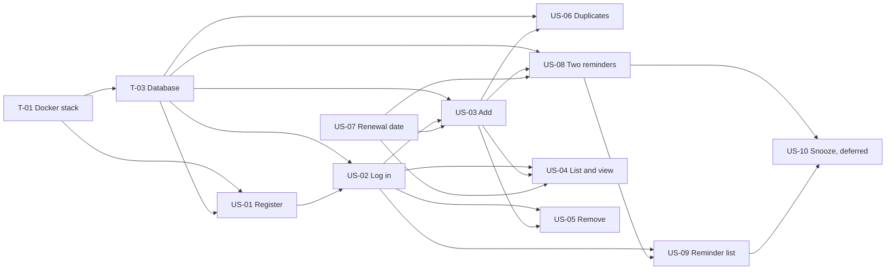

# Initial Product Backlog

**Project:** Subscription Reminder Mobile Application
**Owner:** Zeynep Sude Develi (`zsudedeveli`), Product Owner
**Version / date:** 1.0 · 31 October 2026
**Source of truth for live state:** GitHub issues #9–#24. This file is the Sprint 1 baseline.

## 1. How to read this backlog

- **Hierarchy:** Epic → Feature → Story → Task.
- **Priority:** P1 = needed for the core value of the first release; P2 = needed for a complete first release; P3 = deferred. GitHub labels: `priority-1`, `priority-2`, `priority-3`; milestone `Sprint-1`.
- **Estimate:** story points on the Fibonacci scale (1, 2, 3, 5, 8). These are the PO's **initial** estimates. The team confirms or changes them in planning poker at sprint planning (decision D-15).
- **Owner:** the person *proposed* to implement. Final assignment is made by the team at sprint planning. QA owns the verification of every story.
- **Definition of Ready** and **Definition of Done** are in section 6.

## 2. Epics and features

| Epic | Value | Features | Stories |
|---|---|---|---|
| **E1 · Account and access** | Users keep private data and nobody else can see it. | F1.1 Register · F1.2 Log in and protect endpoints | US-01, US-02 |
| **E2 · Subscription management** | Users keep one correct list of their subscriptions. | F2.1 Add and validate · F2.2 View · F2.3 Remove from tracking · F2.4 Renewal date | US-03, US-04, US-05, US-06, US-07 |
| **E3 · Renewal reminders** | Users are warned before each renewal. | F3.1 Reminder generation · F3.2 Reminder visibility · F3.3 Snooze (deferred) | US-08, US-09, US-10 |
| **E4 · Engineering foundation (enablers)** | The team can build, test and deliver with evidence. | F4.0 Docker stack · F4.1 CI and rulesets · F4.2 Database · F4.3 Test plan · F4.4 Mobile skeleton · F4.5 Process calendar | T-01 to T-06 |

## 3. Prioritized user stories

Order of work (top first). Dependencies follow the Architect's dependency comments on the issues. They use story and task identifiers; other prerequisites are named in words.

| Rank | ID | Issue | Story | Epic | Priority | Points | Depends on | Proposed owner |
|---:|---|---|---|---|---|---:|---|---|
| 1 | US-01 | #9 | As a new user, I can register with email and password so that I have a private account. | E1 | P1 | 3 | T-01, T-03 | Implementation (Emre Alay) |
| 2 | US-02 | #10 | As a registered user, I can log in so that I can reach my own data, and unauthenticated requests are refused. | E1 | P1 | 5 | US-01, T-03 | Implementation (Emre Alay) |
| 3 | US-03 | #11 | As a user, I can add a subscription (service, amount, period, start date) so that it is tracked. | E2 | P1 | 3 | US-02, US-07, T-03 | Implementation (Emre Alay) |
| 4 | US-07 | #15 | As a user, I see the correct next renewal date of each subscription, including month-end and leap-year cases. | E2 | P1 | 5 | none (pure function) | Architect (ybyaman) + QA |
| 5 | US-04 | #12 | As a user, I can see my list of subscriptions and open one subscription to view its details. | E2 | P1 | 5 | US-02, US-03, US-07 | Implementation (Emre Alay) |
| 6 | US-08 | #16 | As a user, I receive a reminder 3 days and 1 day before each renewal, once each. | E3 | **P1** (raised from P2, D-14) | 8 | US-03, US-07, T-03 | Architect (ybyaman) |
| 7 | US-05 | #13 | As a user, I can remove a subscription from tracking and I am told the real subscription is not cancelled. | E2 | P2 | 3 | US-02, US-03 | Implementation (Emre Alay) |
| 8 | US-06 | #14 | As a user, I cannot create the same active subscription twice. | E2 | P2 | 2 | US-03, T-03 | Implementation (Emre Alay) |
| 9 | US-09 | #17 | As a user, I can see a read-only list of my reminders. | E3 | P2 | 3 | US-02, US-08 | Architect (ybyaman) |
| – | US-10 | #18 | As a user, I can snooze a reminder. | E3 | P3 (deferred) | 3 | US-08, US-09 | Not in first release |

**Total for stories in the first release (US-01 … US-09): 37 points.** US-10 is excluded.

### Why US-08 is P1

The two-reminder feature is the core value of the product (the hypothesis in the proposal). Without it, the application is only a list. US-06 stays P2: the system works without duplicate protection, but the data is cleaner with it.

## 4. Acceptance criteria

Criteria are written so that QA can derive tests directly. `AT-nn` is the identifier of an acceptance scenario of this backlog. The QA test plan (T-04, `docs/qa/`) uses its own `QA-*` scenario identifiers.

### US-01 · Register (#9) — FR-01
- Valid email and password of at least 8 characters → `201`, account created, password stored hashed. (AT-01)
- Invalid email, password shorter than 8 characters, or missing field → `400` with `{code, message}`. (AT-02)
- Email already registered (case-insensitive) → `409`, no second account. (AT-03)

### US-02 · Log in (#10) — FR-02, FR-03
- Valid credentials → `200` with a JWT. (AT-04)
- Wrong password and unknown email → `401` with the **same** message. (AT-05)
- Malformed body → `400`. (AT-06)
- `GET /subscriptions`, `POST /subscriptions`, `GET /reminders` without a token → `401`. (AT-07)

### US-03 · Add subscription (#11) — FR-04
- Netflix, 22999 kuruş, monthly, valid start date → `201` and `nextRenewalDate` is returned. (AT-08)
- Amount 0 or negative, empty name, name of 101 characters, `weekly` period, missing start date, start date outside the allowed range → `400`. (AT-09)

### US-04 · List and view subscriptions (#12) — FR-03, FR-07, FR-08
- The list contains only the caller's subscriptions with name, amount, period, next renewal date and a `reminders` array. (AT-11)
- `GET /subscriptions/{id}` of another user's subscription or an unknown id → `404`, not `403`. (AT-10)

### US-05 · Remove from tracking (#13) — FR-09, FR-12
- Cancel an active owned subscription → `200`, status `cancelled`. The interface shows the warning that the provider subscription is not cancelled. (AT-16)
- Cancel twice → `409`; unknown or foreign id → `404`. (AT-17)
- After removal no new reminders are created; earlier reminders stay visible. (AT-26)

### US-06 · Prevent duplicates (#14) — FR-05
- Active "Netflix / monthly" exists; adding "netflix / monthly" → `409`, nothing created. (AT-12)
- Same service with period `yearly` → `201`. (AT-13)
- Another user adds the same service and period → `201`. (AT-14)
- After removal, the same service and period can be added again → `201`. (AT-15)

### US-07 · Renewal date (#15) — FR-06
- Monthly, start 31 Jan 2027 → 28 Feb 2027, then 31 Mar 2027. (AT-18)
- Monthly, start 31 Jan 2028 (leap year) → 29 Feb 2028, then 31 Mar 2028. (AT-19)
- Yearly, start 29 Feb 2028 → 28 Feb 2029, 2030, 2031, then 29 Feb 2032. (AT-20)
- Monthly, start 31 Jan, consecutive months → 31 Mar, 30 Apr, 31 May (no drift). (AT-21)
- If today is a renewal date, the next renewal date is the following period (not today).
- If the start date is in the future, the first renewal date is the start date plus one period.

### US-08 · Two reminders (#16) — FR-10, FR-11, FR-12
- Job on `renewalDate − 3` → one 3-day reminder with status `sent_mock`. (AT-22)
- Job on `renewalDate − 1` → one 1-day reminder. (AT-23)
- Job run twice for the same date → no duplicate rows. (AT-24)
- Subscription added 2 days before renewal → only the 1-day reminder. (AT-25)
- Cancel, then run the job in the reminder window → no new reminder. (AT-26)
- After the renewal date passes the next cycle gets its own two reminders. (AT-27)
- If the job did not run on a reminder date, the next run makes up the missed reminder while the renewal day has not arrived (ADR-002).
- Subscription added after 09:00 on its **3-day** date → the 3-day reminder is made up at the next job run; added after 09:00 on its **1-day** date → no catch-up for the 1-day reminder (ADR-002). Thresholds dated before the subscription was added are never created. (AT-30)

### US-09 · Reminder list (#17) — FR-13
- Only the caller's reminders, newest `remindOn` first; unauthenticated call → `401`. (AT-28)
- `POST`, `PUT`, `PATCH` and `DELETE` on `/reminders` are not offered (`405`). (AT-29)

### US-10 · Snooze (#18) — deferred
- Out of scope for the first release. No acceptance criteria are committed.

## 5. Technical (enabler) tasks

| ID | Issue | Task | Epic | Points | Depends on | Proposed owner |
|---|---|---|---|---:|---|---|
| T-01 | #19 | Docker Compose stack (API and database) | E4 | 3 | none | DevOps (AhmeTalhAkyol) |
| T-02 | #20 | CI checks and repository ruleset (GitHub Actions: ruff, pytest, Spectral OpenAPI lint; required checks `backend-test` and `openapi-lint`) | E4 | 3 | Backend skeleton pull request merged; CI workflow has run | Architect (ybyaman) |
| T-03 | #21 | Database schema and Alembic migration on PostgreSQL (users, subscriptions with partial unique index on active rows, reminders with unique constraint) | E4 | 3 | Backend skeleton, T-01, ADR-003 | DevOps (AhmeTalhAkyol) |
| T-04 | #22 | QA test plan and acceptance test suite (`docs/qa/`) | E4 | 3 | OpenAPI pull request merged; PO approval of this backlog | QA (nadirtaskiran) |
| T-05 | #23 | Android application skeleton in React Native with Expo (three screens, API client from the contract) | E4 | 5 | OpenAPI contract | Implementation (Emre Alay) |
| T-06 | #24 | Scrum Master sprint calendar and ceremonies | E4 | 1 | none | Scrum Master (ynessakar) |

## 6. Definitions

### Definition of Ready (a story may enter a sprint when…)
- The user, capability and value are explicit.
- Acceptance criteria are testable and cover the main behavior and the main failures.
- Dependencies and API impact are understood and the contract already contains the operation.
- The item is small enough to finish in one sprint (at most 8 points).
- Unresolved questions have an owner and a date.

### Definition of Done (a story is done when…)
- The code is in a pull request that links the issue and has been reviewed by someone other than the author.
- The acceptance criteria are verified by automated tests that pass in CI.
- The behavior matches `api/openapi.yaml` (or the contract is changed through the Architect).
- Test coverage is at least 50%.
- Evidence (pull request, test run) is linked in the traceability matrix.

## 7. Dependency overview

## 8. Changes against earlier drafts

- US-08 priority raised from P2 to **P1** (D-14). The GitHub label of issue #16 must be changed from `priority-2` to `priority-1`.
- Single-subscription view (FR-08) added to US-04 instead of a new story (D-17).
- Dependencies and the owners follow the Architect's comments and the GitHub assignees (owners of US-08 and US-09 are the Architect; T-02 is assigned to the Architect).
- Story points added as initial estimates (D-15). The earlier suggestions in the Product Pack were not adopted unchanged.
