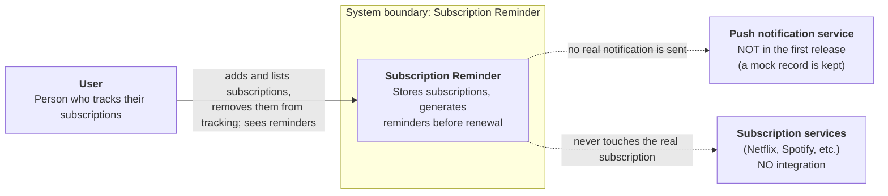
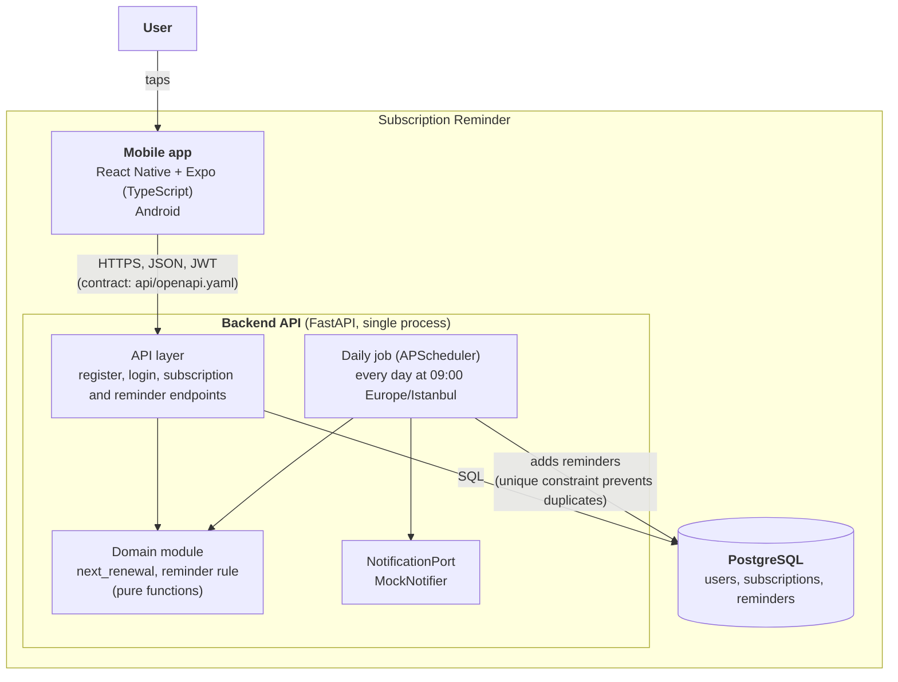
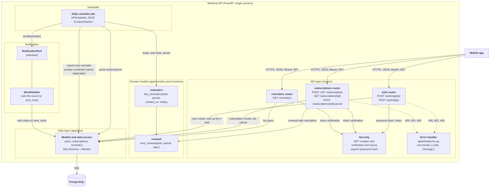
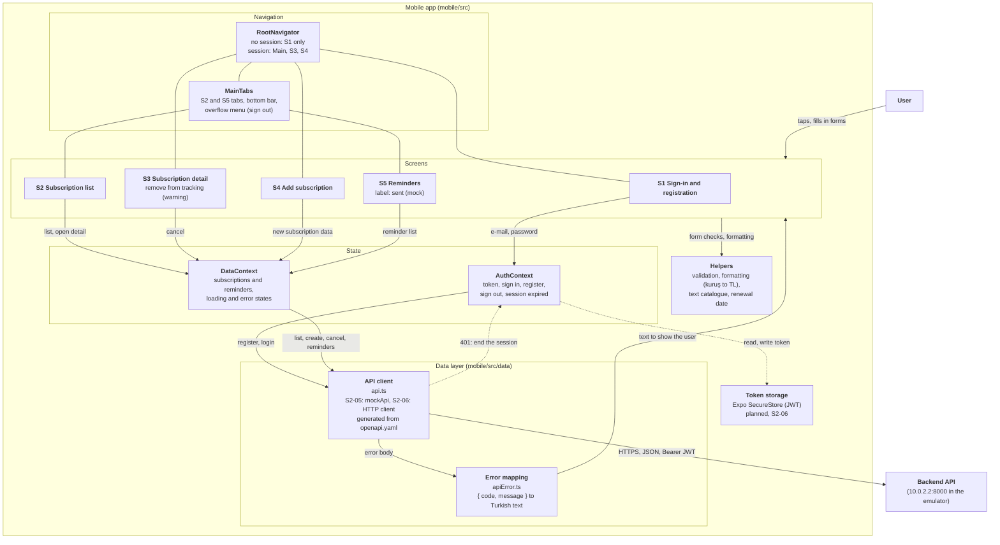

# C4 Diagrams: Subscription Reminder
 
GitHub renders the Mermaid diagrams on this page automatically. The text on each arrow says what is carried over that connection.
 
## Level 1: System context (system boundary)
 
Who uses the system, and who does the system talk to?
 

 
**Inside the system boundary:** the mobile app, the backend API and the database.
 
**Outside the system boundary (on purpose):**
- Subscription services: The app only stores what the user enters. Removing a subscription from tracking does not cancel the real subscription at the service.
- Real push notifications: The first release keeps a mock record (`NotificationPort` interface, `MockNotifier` implementation).
- Payments, banking, reading e-mail, multiple currencies, iOS.
## Level 2: Containers
 
Which running parts does the system consist of, and how do they talk to each other?
 

 
| Part | Responsibility | Decision record |
|---|---|---|
| Mobile app | Screens (login, subscription list, add), API calls; internals in Level 3 | ADR-004 |
| API layer | Request validation, authentication (JWT), responses | ADR-001, ADR-004 |
| Domain module | Renewal date and reminder rules; independent of web and database | ADR-003 |
| Daily job | Generates the reminders for 3 days and 1 day before renewal | ADR-002 |
| NotificationPort | Notification interface; mock record in the first release | ADR-002 |
| PostgreSQL | Persistent data; unique constraints also protect the rules in the database | ADR-002, ADR-003 |
 
How it runs: Docker Compose starts two containers: `api` (API + daily job) and `db` (PostgreSQL). The mobile app runs on the device. In the Android emulator the API address is `http://10.0.2.2:8000`.
 
Change introduced in Sprint 2: The mobile app calls the API through a typed client generated from the `api/openapi.yaml` contract (S2-06). During development, the Prism mock server can be used before the backend is ready.
 
## Level 3: Components (Backend API)
 
The inside of the `api` container. The text on each arrow says what is carried. Dependencies point one way only: `domain/` depends on nothing (ADR-001).
 
Status note: At the end of Sprint 1 the code contains only `domain/` (renewal, reminders), `infra/` (config, db, errors, models) and the `/health` endpoint. The routers, the security layer, the daily job and `MockNotifier` are design and have not been written yet.
 

 
| Component | Responsibility | Decision record |
|---|---|---|
| auth router | Register and login; lower-cases the e-mail, returns a token | ADR-004 |
| subscriptions router | Create, list, get one, cancel a subscription; ownership check | ADR-001 |
| reminders router | The user's reminder list | ADR-002 |
| Security | JWT (24 hours), argon2; secret key comes from the `JWT_SECRET` environment variable | ADR-004 |
| Error handler | `app/infra/errors.py`; returns every error as `{ code, message }` (codes in English, messages in Turkish) | ADR-004 |
| renewal | Renewal date: calculated from the start date, last day of the month in short months | ADR-003 |
| reminders (domain) | Reminders due today for 3 days and 1 day before; does not generate one that falls in the past, catches up on missed ones | ADR-002 |
| Models and data access | `app/infra/models.py`, `db.py`; database access; partial unique indexes and CHECK constraints are in the schema | ADR-001, ADR-003 |
| Daily reminder job | Every day at 09:00; inserts the record and hands it to `NotificationPort`; silently skips a unique-constraint error | ADR-002 |
| NotificationPort / MockNotifier | Mock record instead of real push; if real push is added, only the adapter changes | ADR-002 |
 
## Level 3: Components (Mobile app)

The inside of the Android app (React Native + Expo, TypeScript, `mobile/`). The app has five screens (D-23): S1 sign-in and registration, S2 subscription list, S3 subscription detail, S4 add subscription, S5 reminders. S2 and S5 are tabs of one main view with a bottom bar; S1, S3 and S4 are full screens. The screens follow the Figma prototype (S2-04) and `docs/product/08-user-flows-and-prototype-spec.md`.

Status note: The screens, navigation and state are built (S2-05). The data layer currently returns mock data (`mockApi`). The HTTP client generated from `api/openapi.yaml` and token storage in Expo SecureStore are planned for S2-06.

| Component | Responsibility |
|---|---|
| RootNavigator | Shows only S1 without a session; with a session it shows the main view, S3 and S4. After sign-out or a `401` it returns to S1 and the back button does not return to data screens (flow F6) |
| MainTabs | Hosts S2 and S5 with the bottom bar and the overflow menu; the bottom bar is hidden on S1, S3 and S4 |
| Screens | Show the empty, filled and error states; do not call the API directly, they use the contexts |
| AuthContext | Holds the session token; registration signs the user in automatically (D-23); a `401` ends the session with "Oturumunuz sona erdi." (D-24) |
| DataContext | Holds the subscription and reminder lists and their loading and error states |
| API client | The single place for network calls; the types come from the contract and are never edited by hand |
| Error mapping | Turns errors such as 400, 401 and 409 into Turkish messages (D-19) |
| Helpers | Form validation, amount entry in lira converted to integer kuruş without rounding (D-26), amount display as `229,99 ₺`, renewal date for display |
| Token storage | The JWT is kept in secure storage on the device (NFR-S5); in S2-05 it is only in memory |

These diagrams are consistent with the class and sequence diagrams in `docs/architecture/uml.md`. Class names are the same as in the domain module.