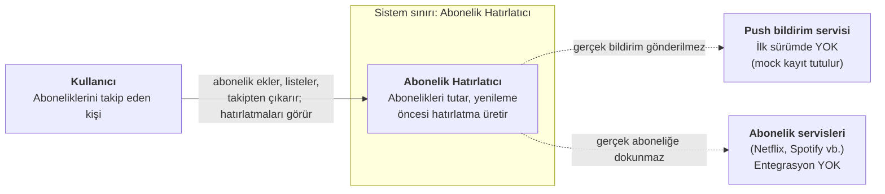
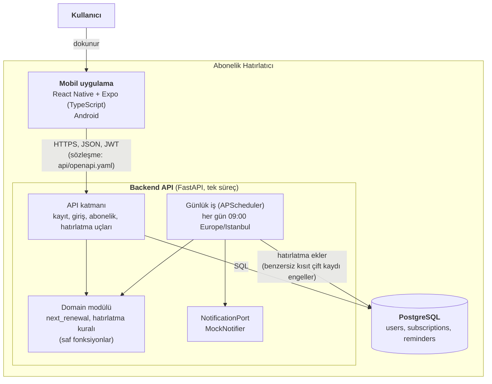

# C4 Diyagramları: Abonelik Hatırlatıcı

GitHub bu sayfadaki Mermaid diyagramlarını otomatik çizer. Her ok üzerindeki yazı, o bağlantıda ne taşındığını söyler.

## Seviye 1: Sistem bağlamı (sistem sınırı)

Kim sistemi kullanır ve sistem kimlerle konuşur?

**Sistem sınırı içinde:** Mobil uygulama, backend API ve veritabanı.

**Sistem sınırı dışında (bilinçli olarak):**
- Abonelik servisleri: Uygulama yalnızca kullanıcının girdiği bilgiyi tutar. Takipten çıkarmak servisteki gerçek aboneliği iptal etmez.
- Gerçek push bildirimi: İlk sürümde mock kayıt tutulur (`NotificationPort` arayüzü, `MockNotifier` uygulaması).
- Ödeme, banka, e-posta okuma, çoklu para birimi, iOS.

## Seviye 2: Konteynerler

Sistem hangi çalışan parçalardan oluşur ve bunlar nasıl konuşur?

| Parça | Sorumluluk | Karar kaydı |
|---|---|---|
| Mobil uygulama | Ekranlar (giriş, abonelik listesi, ekleme), API çağrıları | ADR-004 |
| API katmanı | İstek doğrulama, kimlik doğrulama (JWT), yanıtlar | ADR-001, ADR-004 |
| Domain modülü | Yenileme tarihi ve hatırlatma kuralları; web ve veritabanından bağımsız | ADR-003 |
| Günlük iş | 3 gün ve 1 gün önceki hatırlatmaları üretir | ADR-002 |
| NotificationPort | Bildirim arayüzü; ilk sürümde mock kayıt | ADR-002 |
| PostgreSQL | Kalıcı veri; benzersiz kısıtlar kuralları veritabanında da korur | ADR-002, ADR-003 |

Çalışma biçimi: Docker Compose ile iki konteyner ayağa kalkar: `api` (API + günlük iş) ve `db` (PostgreSQL). Mobil uygulama cihazda çalışır.
