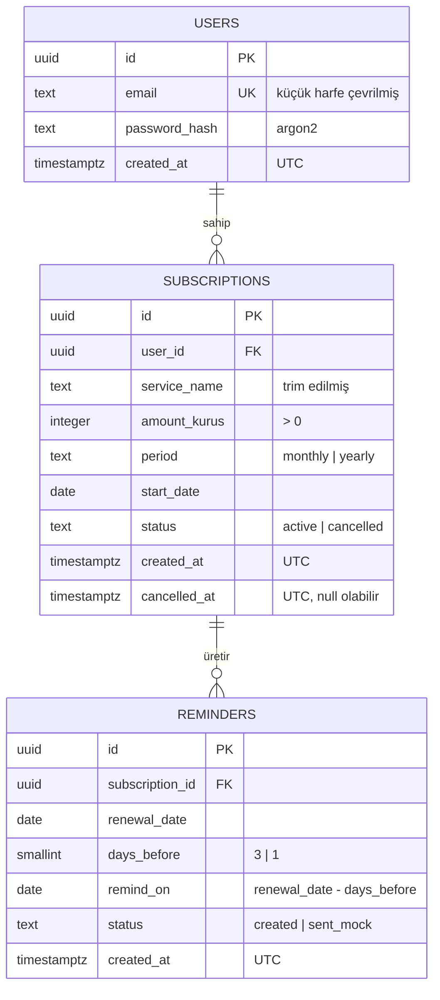

# Veritabanı Şeması (PostgreSQL)

Bu belge `api/openapi.yaml` sözleşmesiyle birebir uyumludur. Şemanın tek kaynağı bu belgedir; kod (SQLAlchemy modelleri + Alembic migration) bu belgeye uyar. Değişiklik gerekirse önce bu belge PR ile güncellenir.

- Sahip: Architect (Buğra) · Kodlayan: Implementation (Faldozn) · DB ortamı: DevOps (Ahmet)
- İlgili kararlar: ADR-002 (hatırlatma üretimi), ADR-003 (para ve tarih)

## ER Diyagramı

## Tablolar

### users
| Alan | Tip | Kısıt |
| --- | --- | --- |
| id | uuid | PK |
| email | text | NOT NULL, UNIQUE (kayıtta küçük harfe çevrilir) |
| password_hash | text | NOT NULL (argon2) |
| created_at | timestamptz | NOT NULL, varsayılan now() |

### subscriptions
| Alan | Tip | Kısıt |
| --- | --- | --- |
| id | uuid | PK |
| user_id | uuid | NOT NULL, FK → users(id) |
| service_name | text | NOT NULL, boş olamaz (trim sonrası) |
| amount_kurus | integer | NOT NULL, CHECK (amount_kurus > 0) |
| period | text | NOT NULL, CHECK (period IN ('monthly','yearly')) |
| start_date | date | NOT NULL |
| status | text | NOT NULL, CHECK (status IN ('active','cancelled')), varsayılan 'active' |
| created_at | timestamptz | NOT NULL, varsayılan now() |
| cancelled_at | timestamptz | NULL (iptalde doldurulur) |

Yenileme tarihi saklanmaz; `backend/app/domain/renewal.py` ile `start_date`'ten hesaplanır.

### reminders
| Alan | Tip | Kısıt |
| --- | --- | --- |
| id | uuid | PK |
| subscription_id | uuid | NOT NULL, FK → subscriptions(id) |
| renewal_date | date | NOT NULL |
| days_before | smallint | NOT NULL, CHECK (days_before IN (3, 1)) |
| remind_on | date | NOT NULL (= renewal_date − days_before; zamanlayıcı bu alanı sorgular) |
| status | text | NOT NULL, CHECK (status IN ('created','sent_mock')), varsayılan 'created' |
| created_at | timestamptz | NOT NULL, varsayılan now() |

## Kısıtlar ve indeksler (iş kurallarının karşılığı)

| Kural | Veritabanı karşılığı |
| --- | --- |
| Aynı kullanıcıda aynı servis adı + periyotla tek aktif abonelik (409) | Kısmi unique indeks: `UNIQUE (user_id, lower(service_name), period) WHERE status = 'active'` |
| Her hatırlatma yalnızca bir kez üretilir | `UNIQUE (subscription_id, renewal_date, days_before)` |
| Tutar pozitif tam sayı (kuruş) | `CHECK (amount_kurus > 0)` |
| Yalnızca 3 ve 1 gün kala hatırlatma | `CHECK (days_before IN (3, 1))` |
| E-posta tekrar kaydedilemez | `UNIQUE (email)` |
| Günlük iş (09:00) bugünün hatırlatmalarını bulur | İndeks: `reminders (remind_on, status)` |
| Kullanıcının abonelik listesi | İndeks: `subscriptions (user_id, status)` |

## Davranış kuralları

- İptal (`cancel`): `status='cancelled'`, `cancelled_at` doldurulur. Satır silinmez; mevcut hatırlatmalar kalır, yenisi üretilmez.
- Başka kullanıcının kaydı sorgulanırsa 404 döner (sorgu her zaman `user_id` ile filtrelenir).
- Geç eklenen abonelikte yalnızca kalan hatırlatma günleri için satır üretilir (ADR-002).
- Tüm zaman damgaları UTC; yenileme ve hatırlatma günleri `date` (ADR-003).
- Şema değişiklikleri yalnızca Alembic migration ile yapılır; elle `CREATE TABLE` yok.

## OpenAPI eşlemesi

| API alanı | DB alanı |
| --- | --- |
| `amountKurus` | `subscriptions.amount_kurus` |
| `serviceName` | `subscriptions.service_name` |
| `startDate` | `subscriptions.start_date` |
| `nextRenewalDate` | hesaplanır, saklanmaz |
| `reminders[].remindOn` | `reminders.remind_on` |
| `reminders[].daysBefore` | `reminders.days_before` |
| `reminders[].status` | `reminders.status` |
