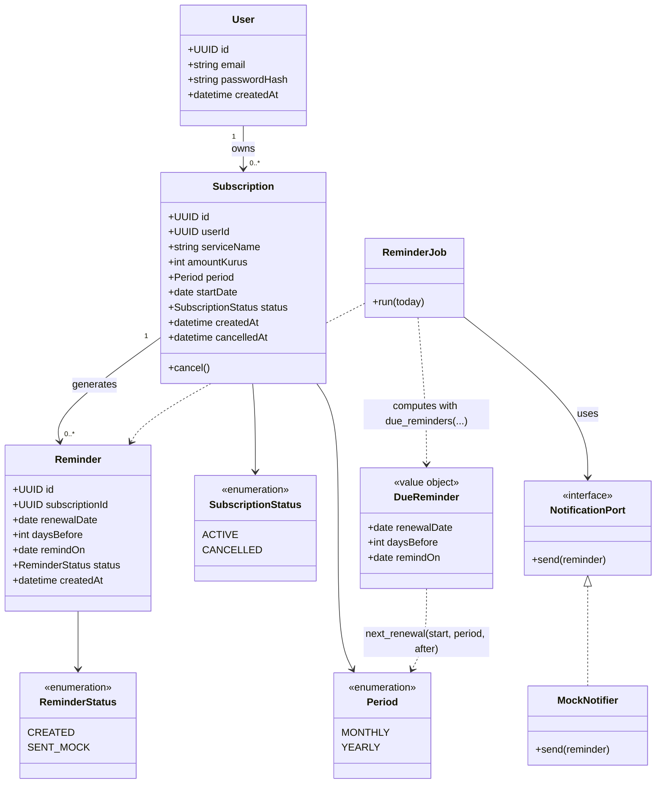
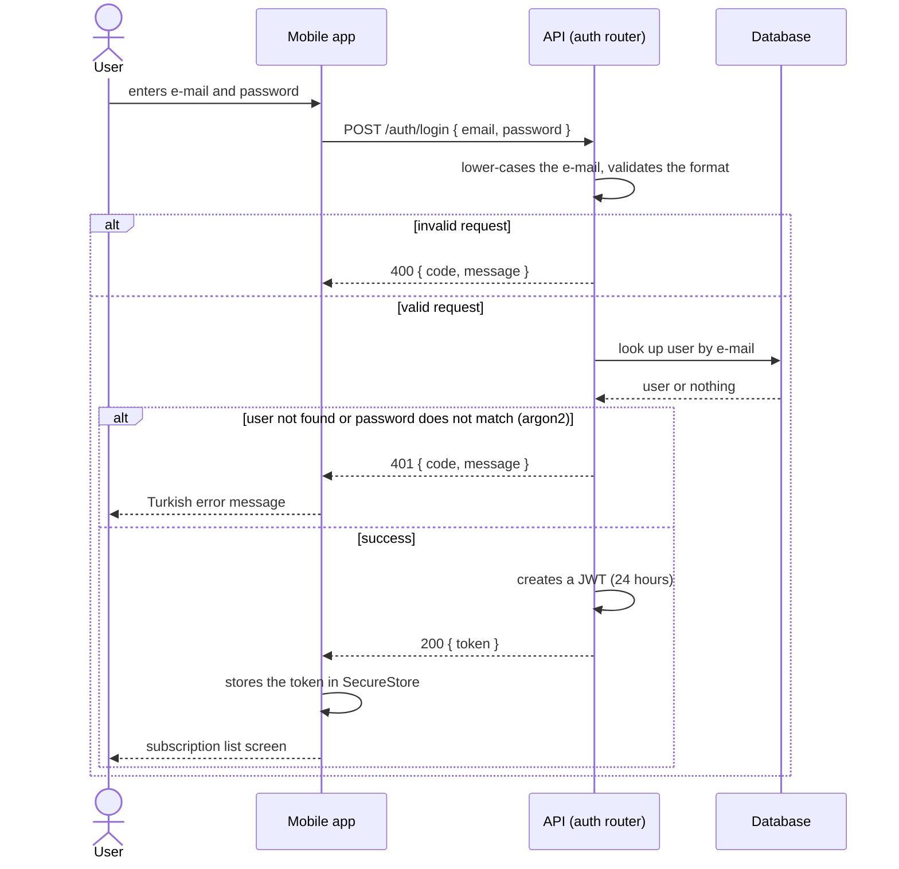
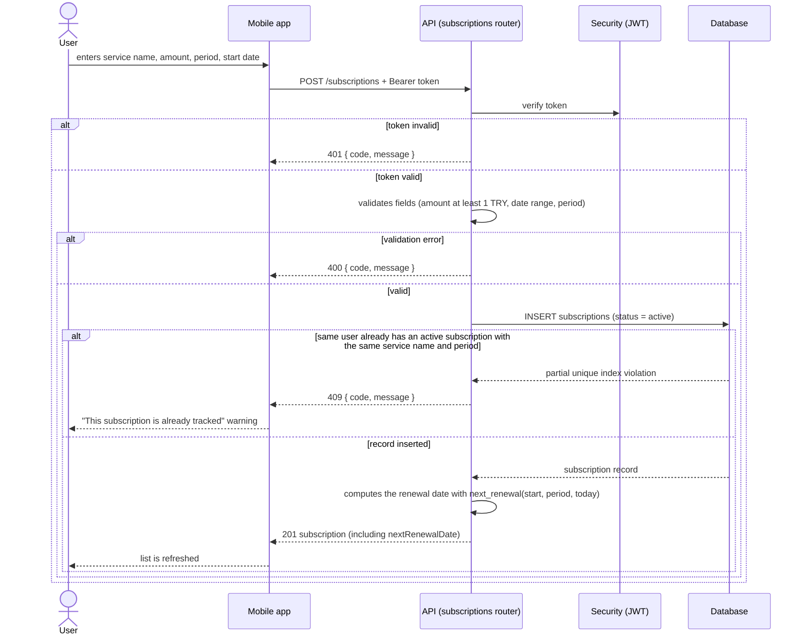
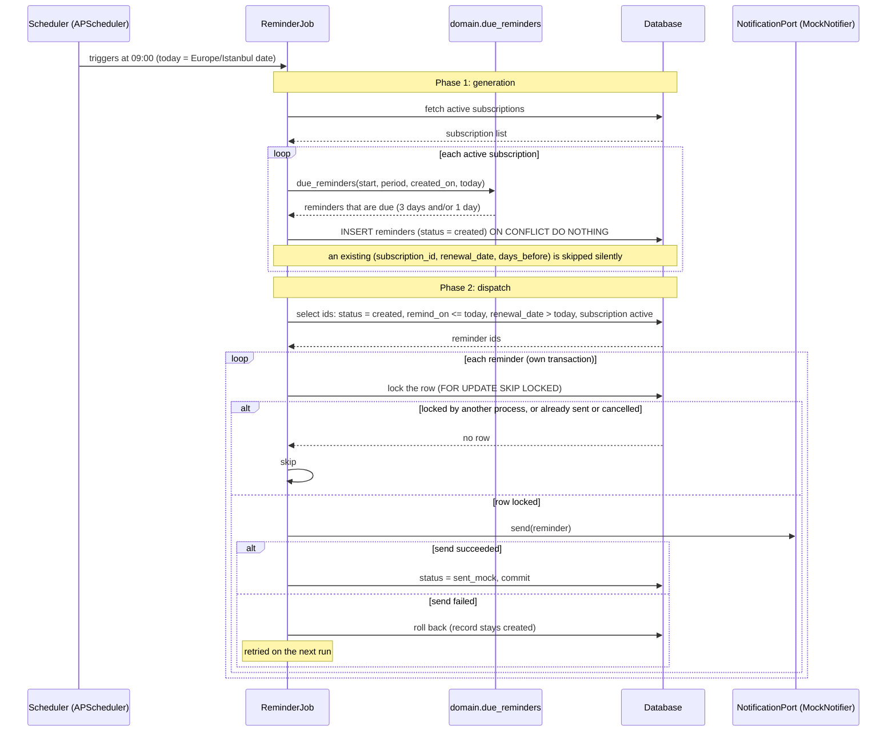
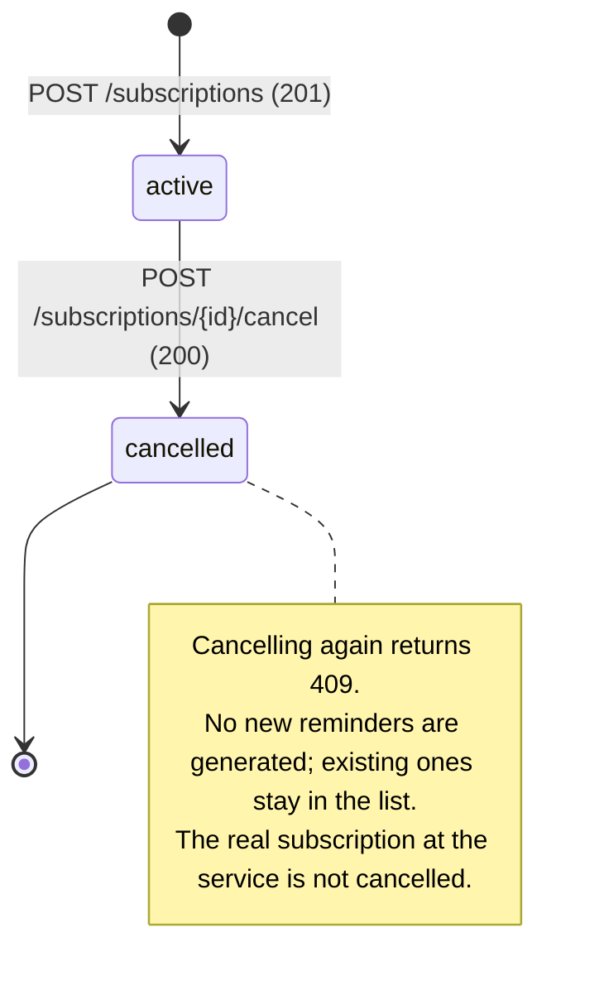
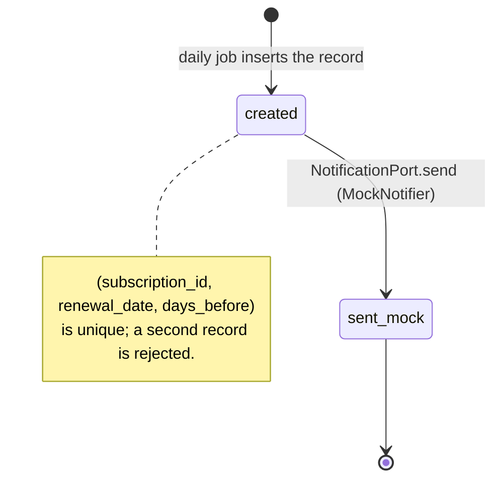
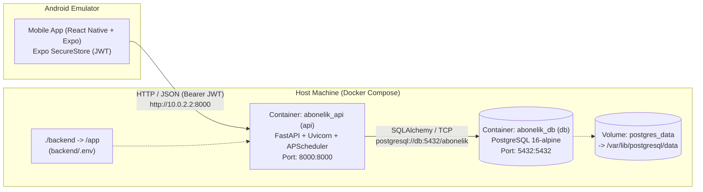

# UML Diagrams: Subscription Reminder

GitHub renders the Mermaid diagrams on this page automatically. The diagrams are consistent with the `api/openapi.yaml` contract, `docs/architecture/db-semasi.md` and the ADRs; if they ever conflict, the contract and the ADRs win.

Contents: 1. Class diagram · 2. Sequence diagrams (login, create subscription, daily reminder job) · 3. State diagrams · 4. Deployment diagram (S2-12, added by DevOps)

## 1. Class diagram

Scope: User, Subscription, Reminder, Period and NotificationPort. The domain types (`Period`, `DueReminder`) are pure code; `User`, `Subscription` and `Reminder` correspond to the database tables.

Notes:
- `User`, `Subscription` and `Reminder` match `backend/app/infra/models.py`, and `Period` and `DueReminder` match `backend/app/domain/`. `ReminderJob` is implemented by the functions in `backend/app/services/reminder_job.py`, `NotificationPort` by `backend/app/domain/notifications.py` and `MockNotifier` by `backend/app/infra/notifier.py`.
- The renewal date is not stored; it is computed from `start_date` and `period` with `next_renewal` (ADR-003).
- `(subscriptionId, renewalDate, daysBefore)` is unique; the database prevents duplicate reminders (ADR-002).
- A user can have only one active subscription with the same service name and period (409).
- A real push adapter can be added without changing `NotificationPort` (ADR-002).

## 2. Sequence diagrams

### 2.1 Login (`POST /auth/login`)

### 2.2 Create subscription (`POST /subscriptions`, 201 and 409)

### 2.3 Daily reminder job (including the duplicate-send constraint)

The job runs inside the API process every day at 09:00 (Europe/Istanbul) (ADR-002). The job has two phases and each can be repeated safely. Even if the job runs twice, or two API copies run, a reminder is saved and sent only once.

Rules (ADR-002): `R` is the first renewal day strictly after today; a record is inserted only if `remind_on ≤ today` and `remind_on ≥` the day the subscription was added. A record is sent only if its status is `created`, `remind_on ≤ today` and `renewal_date > today`. If the server is down at 09:00, the reminders that are due are generated and sent on the next run. On the renewal day `R` moves to the next period, so no reminder is produced for that day. Known limitation: if a subscription is added on a reminder day after 09:00, that day's reminder is not generated. A cancelled subscription gets no new reminders; existing ones stay in the list but are not sent.

## 3. State diagrams

### 3.1 Subscription

### 3.2 Reminder

## 4. Deployment diagram

Docker Compose (`api` and `db` containers) on the host machine and the React Native (Expo) mobile app running on the Android Emulator ([ADR-001](../adr/ADR-001-moduler-monolit.md), [ADR-004](../adr/ADR-004-teknoloji-secimi.md)).

Notes:
- The Android Emulator reaches the host machine's port `8000` via `http://10.0.2.2:8000`.
- `api` waits for `db` (`pg_isready` healthcheck) and runs `alembic upgrade head` on startup.
- Runtime configuration is read from `backend/.env` (template: `backend/.env.example` with `DATABASE_URL`, `JWT_SECRET`, `JWT_EXPIRE_MINUTES`, `TZ=Europe/Istanbul`).

## Related documents
- Decision records: [ADR-001](../adr/ADR-001-moduler-monolit.md), [ADR-002](../adr/ADR-002-hatirlatma-uretimi.md), [ADR-003](../adr/ADR-003-para-ve-tarih.md), [ADR-004](../adr/ADR-004-teknoloji-secimi.md)
- Component and container view: [c4-diyagramlar.md](c4-diyagramlar.md)
- Data model: [db-semasi.md](db-semasi.md)