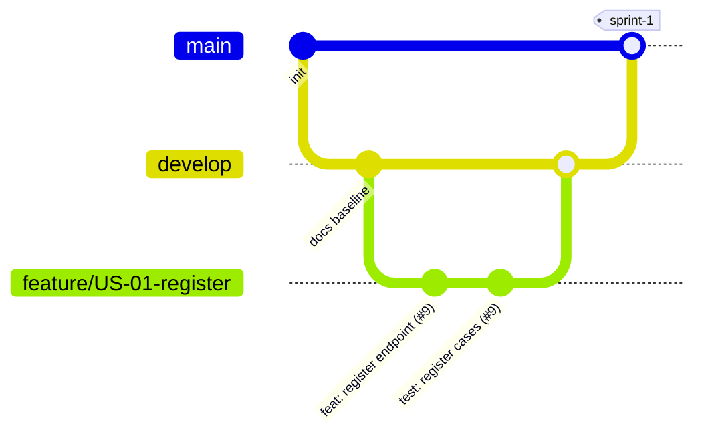

# GitHub Repository and Git-Flow Workflow

**Repository:** https://github.com/ybyaman/abonelik-ve-fatura-hatirlatici
**Version / date:** 1.0 · 31 October 2026
**Owners:** Lead Architect (accountable), DevOps Engineer (responsible), Scrum Master (consulted)
**Decision:** D-18 (feature branches start from `develop`)

## 1. Repository organization

```text
.
├── LICENSE                         MIT license text
├── README.md                       Purpose, how to run, scope note (invoices are out of scope)
├── CONTRIBUTING.md                 Summary of this workflow
├── CODEOWNERS                      api/ → Lead Architect
├── api/
│   └── openapi.yaml                OpenAPI contract
├── docs/
│   ├── SPRINT-1-SUBMISSION.md      Submission cover and evidence links
│   ├── product/                    Proposal, vision, requirements, backlog, decision log
│   └── process/                    RACI, this workflow
├── .github/
│   ├── pull_request_template.md
│   └── ISSUE_TEMPLATE/
├── backend/                        API and daily job (later sprints)
├── mobile/                         Android application (later sprints)
└── docker-compose.yml              API and database
```

## 2. Branching strategy

```text
main        Assessed and released versions only. Every sprint submission receives a tag.
develop     Integrated work intended for the next sprint release.
feature/<issue>-<short-name>   Short-lived branch for one story, defect or task.
release/<version>              Optional stabilization branch; created only if a real need exists.
hotfix/<issue>-<short-name>    Optional urgent repair based on a released main version.
```



The model is deliberately lightweight. Short feature branches and reviewed pull requests matter more than unused branch types. `release/*` and `hotfix/*` are created only when needed.

### Naming conventions

| Item | Convention | Example |
|---|---|---|
| Feature branch | `feature/<story-id>-<short-name>` | `feature/US-08-two-reminders` |
| Task branch | `feature/<task-id>-<short-name>` | `feature/T-02-ci-checks` |
| Documentation branch | `feature/docs-<short-name>` | `feature/docs-sprint-1-product` |
| Release tag | `sprint-<n>` or `v<major>.<minor>.<patch>` | `sprint-1`, `v1.0.0` |
| Commit message | `<type>: <summary> (#<issue>)` with types `feat`, `fix`, `test`, `docs`, `refactor`, `chore`, `ci` | `feat: create reminder job (#16)` |

## 3. Issues

Every change begins with an issue. Use the story template (`.github/ISSUE_TEMPLATE/user-story.md`).

| Field | Content |
|---|---|
| Title | `US-08 Two reminders` or `T-02 CI checks` |
| Body | Story sentence, purpose, acceptance criteria, dependencies, API impact |
| Assignee | One owner |
| Labels | `p1` / `p2` / `p3`, `story` / `task` / `bug`, epic label (`E1` … `E4`) |
| Milestone | `Sprint 1`, `Sprint 2`, … |
| Estimate | Story points (backlog baseline: docs/product/06-product-backlog.md) |

Existing issues: stories #9–#18, tasks #20–#24. Label of #16 changes to `p1` (D-14).

## 4. Pull requests and peer review

1. Create the branch from `develop` and link the issue.
2. Open a pull request into `develop` using the template; write `Closes #<issue>`.
3. The pull request shows evidence: tests passed, screenshot, or review notes.
4. **At least one teammate who is not the author** reviews correctness, clarity, tests and contract impact. Changes under `api/` need the Lead Architect.
5. Required checks pass.
6. The author never merges their own pull request without an approval. Use squash merge to keep a readable history.
7. At submission, a pull request from `develop` into `main` is reviewed and merged, then the tag is created on `main`.

### Pull request template (`.github/pull_request_template.md`)

The template is provided with this package.

## 5. Branch protection (GitHub rulesets)

Create one ruleset targeting `main` and `develop` (Settings → Rules → Rulesets):

| Rule | Setting |
|---|---|
| Restrict direct pushes | Require a pull request before merging (blocks direct push) |
| Approvals | At least 1 approval; dismiss stale approvals when new commits are pushed |
| Code owners | Require review from code owners (`api/` → Lead Architect) |
| Status checks | Require checks to pass: build, tests with coverage gate (at least 50%), OpenAPI validation |
| Conversation resolution | Require all review conversations to be resolved |
| History | Block force pushes and deletion |
| Bypass | None for team members; the repository owner does not bypass |

Evidence to attach to the submission: screenshot of the ruleset, a pull request showing the required approval, and the check run list (issue #20).

## 6. Traceability and individual contributions

- Every member commits from their own account with the email linked to it.
- Every commit message and branch references an issue; every pull request closes an issue.
- `docs/product/decision-log.md` records who decided what; `docs/process/04-team-roles-and-raci.md` records who is responsible.
- The Sprint 1 submission lists, for each member, the issues, pull requests and commits that belong to them (see `docs/SPRINT-1-SUBMISSION.md`).
- GitHub Insights (contributors graph) and `git shortlog -sne --all` are used to verify that contributions are visible for all six members.

## 7. Release and Sprint 1 tag

```bash
# after the develop → main pull request is approved and merged
git checkout main
git pull
git tag -a sprint-1 -m "Sprint 1 submission"
git push origin sprint-1
```

Create a GitHub release for the tag and paste the submission evidence list into the release notes.

## 8. Contribution checklist for each member

- [ ] An issue exists and is assigned to me.
- [ ] My branch is `feature/<id>-<name>` created from `develop`.
- [ ] My commits reference the issue.
- [ ] My pull request has evidence and a reviewer who is not me.
- [ ] Required checks are green before merge.
