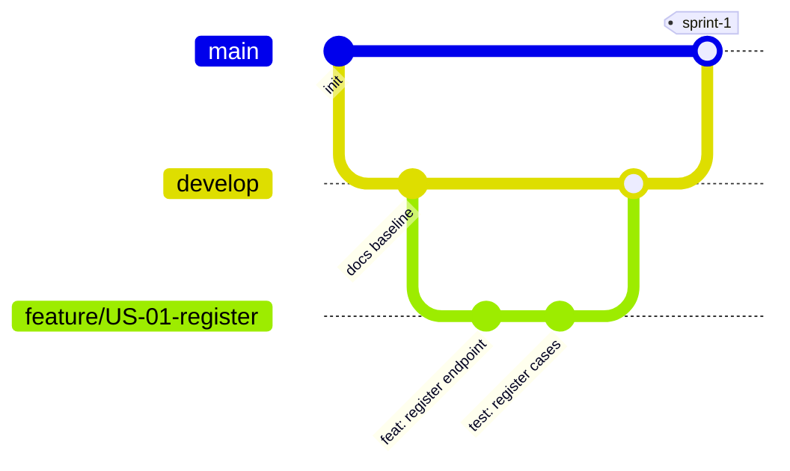

# GitHub Repository and Git-Flow Workflow

**Repository:** https://github.com/AbonelikVeFaturaHatirlatici/abonelik-ve-fatura-hatirlatici
**Version / date:** 1.1 · 1 November 2026
**Owners:** Lead Architect (accountable), DevOps Engineer (responsible), Scrum Master (consulted)
**Decision:** D-18 (feature branches start from `develop`)

This document describes the workflow **as it is configured in the repository today**. Where a rule is enforced by GitHub, the section says so; where it is a team agreement only, the section says that instead.

## 1. Repository organization

```text
.
├── README.md                       Purpose and how to run the stack
├── LICENSE                         MIT license text (added with the product documents)
├── AGENTS.md, CLAUDE.md            Context files for LLM-assisted work
├── docker-compose.yml              API and database
├── .spectral.yaml                  OpenAPI lint rules
├── api/
│   └── openapi.yaml                OpenAPI contract
├── backend/                        FastAPI service, Alembic migrations, tests, Dockerfile
├── mobile/                         Android application (skeleton task T-05)
├── docs/
│   ├── CONTRIBUTING.md             Short contribution rules
│   ├── adr/                        Architecture decision records (ADR-001 … ADR-004)
│   ├── architecture/               Technical architecture v4, C4 diagrams, database schema
│   ├── process/                    RACI, escalation guide, this workflow, LLM working guide
│   └── product/                    Proposal, vision, requirements, backlog, decision log
└── .github/
    ├── CODEOWNERS
    ├── pull_request_template.md
    ├── ISSUE_TEMPLATE/             user_story.md, bug.md, config.yml
    └── workflows/ci.yml            CI jobs: backend-test, openapi-lint
```

## 2. Branching strategy

```text
main        Assessed and released versions only. Every sprint submission receives a tag.
develop     Integrated work intended for the next sprint release.
feature/<id>-<short-name>   Short-lived branch for one story, defect or task.
```

`release/*` and `hotfix/*` branches are not used (see `docs/CONTRIBUTING.md`). The model is deliberately lightweight: short branches and reviewed pull requests matter more than unused branch types.



### Naming conventions

| Item | Convention | Example |
|---|---|---|
| Story branch | `feature/US-<nn>-<short-name>` | `feature/US-08-two-reminders` |
| Other branch types | `fix/…`, `chore/…`, `docs/…` | `fix/hatirlatma-kurali-ve-period`, `docs/db-semasi`, `chore/codeowners-nesibe` |
| Release tag | `sprint-<n>` | `sprint-1` |
| Commit message | `<type>: <short summary>` with types `feat`, `fix`, `test`, `docs`, `refactor`, `chore`, `ci` | `fix: next_renewal raises ValueError for an unsupported period` |

Commit messages carry the change type. The link to the issue is made in the pull request (section 4), so that a commit and its review stay together.

## 3. Issues

Every change begins with an issue, created from a template (`user_story.md` or `bug.md`).

| Field | Content |
|---|---|
| Title | `US-08 …` for stories, `T-02 …` for technical tasks |
| Body | Story sentence, acceptance criteria, API impact, Definition of Ready |
| Assignee | One owner per issue |
| Labels | `user-story`, `task` or `bug`; priority `priority-1`, `priority-2` or `priority-3` |
| Milestone | `Sprint-1` |
| Dependencies | A comment "Bağımlılıklar (Architect notu)" on each story lists what it needs and what it unblocks |

Current backlog: stories US-01 … US-10 are issues #9 … #18; technical tasks T-01 … T-06 are issues #19 … #24. The initial estimates and the proposed owners are in `docs/product/06-product-backlog.md`.

## 4. Pull requests and peer review

1. Create the branch from `develop` (`git checkout develop && git pull`).
2. Open the pull request into `develop` (`gh pr create --base develop`) and fill in the template.
3. Link the issue in the description: `Closes #<issue>` when the pull request completes the issue, `Refs #<issue>` when it only contributes to it.
4. The pull request shows evidence: tests passed, a screenshot, or review notes.
5. At least one teammate who is **not the author** approves. Changes to the contract, ADRs, architecture documents and the domain code are reviewed by the Lead Architect (see `.github/CODEOWNERS`).
6. The required checks `backend-test` and `openapi-lint` pass.
7. Merge with a **merge commit**. The repository also permits squash and rebase merges, but the team uses merge commits by default, so the pull request number stays visible in the history ("Merge pull request #30 …"). A single-commit documentation pull request may be squash-merged when that gives a clearer commit message (for example pull request #47).
8. Delete the branch after the merge (GitHub does not delete it automatically in this repository).
9. At submission, a pull request from `develop` into `main` is reviewed and merged, then the tag is created on `main`.

The pull request template is `.github/pull_request_template.md`.

## 5. Branch protection (GitHub ruleset)

One ruleset, **`main-ve-develop-korumasi`**, status **Active**, targets the default branch (`main`) and `develop`. It has no bypass actors, so the repository owner is also bound by it.

| Rule | Setting in the repository |
|---|---|
| Pull request required | Yes: a direct push to `main` or `develop` is blocked |
| Approvals | 1 required |
| Stale approvals | Dismissed when new commits are pushed |
| Approval of the last push | Required: the person who pushed last cannot be the only approver |
| Review conversations | All must be resolved before merging |
| Code owner review | **Not required.** `CODEOWNERS` requests a review automatically, but approval by an owner is not enforced |
| Required status checks | `backend-test` and `openapi-lint` |
| Force push | Blocked (`non_fast_forward`) |
| Deletion of the branch | Blocked |

Because code owner review is not enforced, the rule "contract changes are reviewed by the Lead Architect" is a **team agreement**, supported by the automatic review request. Enforcing it needs at least two owners per path; this is possible later by turning on "Require review from Code Owners".

**Evidence for the submission (issue #20):** three screenshots of the ruleset page are stored in the repository: [targets and bypass list](evidence/ruleset-1-genel-ve-hedefler.png), [deletion and force push](evidence/ruleset-2-silme-ve-force-push.png) and [pull request and status check details](evidence/ruleset-3-pr-ve-kontrol-ayrintilari.png). A pull request that shows the approval requirement and the check list (for example pull request #30) and the Actions run list complete the evidence.

## 6. Traceability and individual contributions

- Every member commits from their own GitHub account.
- Every pull request names its issue (section 4); the decision log (`docs/product/decision-log.md`) records who decided what; the RACI (`docs/process/04-team-roles-and-raci.md`) records who is responsible.
- Contributions are verified from the repository history, not from this document:

```bash
git shortlog -sne --all                  # commits per author
gh pr list --state merged --limit 100 --json number,title,author \
  --jq '.[] | "#\(.number) \(.author.login) \(.title)"'
gh issue list --state all --limit 100 --json number,assignees \
  --jq '.[] | "#\(.number) \([.assignees[].login] | join(","))"'
```

- GitHub Insights → Contributors shows the same data as a graph.
- The Sprint 1 submission file (`docs/SPRINT-1-SUBMISSION.md`) lists the issues, pull requests and commits of each member, filled in from these commands.

## 7. Release and Sprint 1 tag

```bash
# after the develop → main pull request is approved and merged
git checkout main
git pull
git tag -a sprint-1 -m "Sprint 1 submission"
git push origin sprint-1
```

Create a GitHub release for the tag and paste the submission evidence list into the release notes.

## 8. Contribution checklist for each member

- [ ] An issue exists and is assigned to me.
- [ ] My branch is created from `develop` and named `feature/<id>-<name>` (or `fix/`, `chore/`, `docs/`).
- [ ] My pull request targets `develop`, links the issue (`Closes #` or `Refs #`) and has evidence.
- [ ] My reviewer is not me.
- [ ] `backend-test` and `openapi-lint` are green before the merge.
