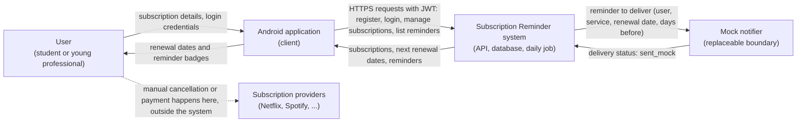

# System Vision and Boundary

**Project:** Subscription Reminder Mobile Application
**Owner:** Zeynep Sude Develi (`zsudedeveli`), Product Owner · **Architect review:** Yusuf Buğra Yaman (`ybyaman`)
**Version / date:** 1.0 · 31 October 2026

---

## 1. Project purpose and target users

### 1.1 Purpose

Help people avoid unwanted subscription renewals by keeping one list of their subscriptions, calculating each next renewal date, and reminding them before it happens.

### 1.2 System vision

> For university students and young professionals who manage several digital subscriptions, the Subscription Reminder application lets users manually record their subscriptions, see the next renewal date of each, and receive reminders 3 days and 1 day before renewal. It only **tracks**: it does not pay for, change, or cancel any subscription.

### 1.3 Target users

| User | Description | Main goals |
|---|---|---|
| Student | Pays for streaming, music and cloud services; limited budget; 3–5 subscriptions is typical. | See what renews soon; avoid charges for services they no longer use. |
| Young professional | Has more subscriptions (software, media, storage) and less time to review them. | One list, clear dates, a prompt before each renewal. |

Both groups use an Android phone. Users create their own account and see only their own data.

---

## 2. System responsibilities and core functionalities

| # | Responsibility | Core functionality | Requirements |
|---|---|---|---|
| 1 | Identity and access | Register and log in with email and password; protect every other operation with a JWT. | FR-01, FR-02, FR-03 |
| 2 | Subscription records | Add, list, view, and remove from tracking (status `cancelled`). | FR-04, FR-07, FR-08, FR-09 |
| 3 | Data integrity | Reject duplicate active subscriptions (same service name and period, case-insensitive). | FR-05 |
| 4 | Renewal calculation | Compute the next renewal date from the start date, with the month-end rule. | FR-06 |
| 5 | Reminder generation | A daily job at 09:00 (Europe/Istanbul) creates reminders for 3 days and 1 day before renewal, once each. | FR-10, FR-11, FR-12 |
| 6 | Reminder visibility | Show reminders inside each subscription and as a flat read-only list. | FR-07, FR-13 |
| 7 | Honest communication | State clearly that removing a subscription does not cancel it at the provider. | FR-09 |

**Terminology.** In the API the operation is named `cancelSubscription`. In product language and in the interface it always means **"remove from tracking"**.

---

## 3. System context and external interactions

### 3.1 Context diagram

### 3.2 Interaction table

Each relationship is described by the information exchanged, its direction, its purpose and the trust assumption.

| # | From → To | Information | Purpose | Trust assumption |
|---|---|---|---|---|
| 1 | User → Application | Subscription details (service name, amount, period, start date), email, password | Record data and authenticate | The user types correct data; the system validates it but cannot verify it against the provider. |
| 2 | Application → System | HTTPS requests with JWT | Invoke the seven API operations | The token is the only proof of identity; every request except register and login is authenticated. |
| 3 | System → Application | Subscription records, next renewal dates, reminders, error objects `{code, message}` | Display data and failures | A user receives only their own records. Another user's record is reported as 404. |
| 4 | System → Notifier | Reminder to deliver | Deliver the reminder | In the first release the notifier is a mock that stores `sent_mock`. A real provider would need device tokens and is out of scope. |
| 5 | Notifier → System | Delivery status | Record the result | Status values are limited to those the contract defines. |
| 6 | User ⇢ Provider | Cancellation or payment | Outside the system | The system never contacts providers and holds no card or bank data. |

---

## 4. In-scope and out-of-scope features

### 4.1 In scope (first release)

- Registration and login (email and password, minimum 8 characters, JWT).
- Add, list, view and remove-from-tracking of subscriptions.
- Monthly and yearly periods; amounts in TRY stored as integer kuruş.
- Next-renewal calculation, including the month-end rule.
- Duplicate prevention.
- Daily reminder job (3 days and 1 day before), mock notifier.
- Read-only reminder list.
- Android application with three screens: login/register, subscription list, add form.
- Warning that removal does not cancel the real subscription.

### 4.2 Out of scope (first release)

| Feature | Reason |
|---|---|
| Cancelling at the provider | Needs provider integration and responsibility the team cannot take. |
| Payments, bank or mailbox integration | Sensitive data and large effort; the product only tracks. |
| Real push notifications and device tokens | Needs a notification provider; replaced by a mock. |
| Weekly periods, multiple currencies, custom schedules | Not required by survey results; deferred. |
| Snoozing reminders (US-10) | Lowest priority; deferred to a later release. |
| Invoices and bills (later release) | The repository name mentions invoices, but the first release tracks subscriptions only. Invoice tracking may follow in a later release (D-22). |
| Analytics, family sharing, social login | Not needed to test the hypothesis. |
| Account deletion | Deferred; recorded as a release risk (R7). |
| iOS, multilingual user interface | Platform and language are fixed for the first release. |

---

## 5. Constraints and assumptions

### 5.1 Constraints

| ID | Constraint |
|---|---|
| C1 | Platform: Android client (React Native with Expo); backend FastAPI (Python) with PostgreSQL, run as one Docker Compose stack (API and database). |
| C2 | API-first: the OpenAPI contract is owned by the Lead Architect and changes only through the Architect. |
| C3 | Currency TRY only; amounts are integers in kuruş (no floating point). |
| C4 | Dates are stored as date-only values interpreted in Europe/Istanbul; timestamps in UTC. |
| C5 | Passwords are hashed (argon2 or bcrypt); no card or bank data is stored. |
| C6 | Every error uses the single schema `{code, message}`; invalid input is always `400`. |
| C7 | Test coverage must not fall below 50% (course threshold). |
| C8 | Team of six; the implementation engineer covers backend and mobile (concentration risk R1). |
| C9 | Sprint 1 focuses on documentation, the API contract and the repository workflow; implementation continues in the later sprints. |

### 5.2 Assumptions

| ID | Assumption |
|---|---|
| A1 | Users are willing to enter subscriptions manually. |
| A2 | Two reminders (3 and 1 day) are enough for users to react. |
| A3 | A mock notifier is acceptable for the course. |
| A4 | Monthly and yearly cover the large majority of consumer subscriptions. |
| A5 | The user enters the date of the first charge (start date); renewals start one period after it (decision D-16). |

### 5.3 Quality attributes

| Attribute | Target |
|---|---|
| Correctness | Date and reminder logic are pure functions that take today's date as input and are unit tested. |
| Security | Hashed passwords, JWT, per-user data isolation. |
| Usability | Add-subscription flow in under 60 seconds in a usability test. |
| Reliability | The daily job is idempotent: a second run creates no duplicates. |
| Maintainability | Contract-first development; reviewed pull requests; coverage at least 50%. |
