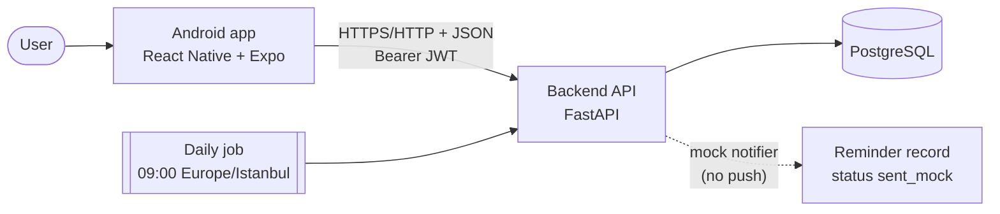
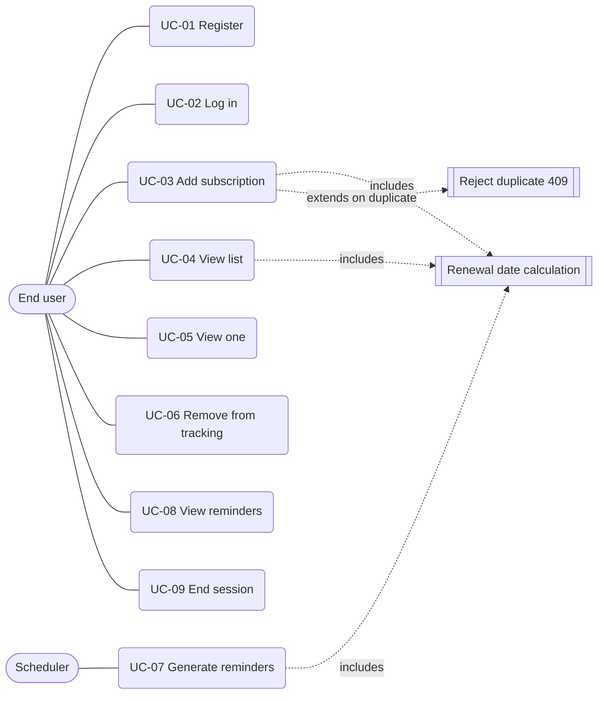
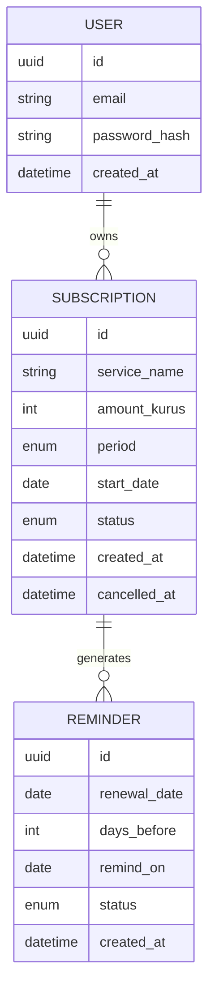
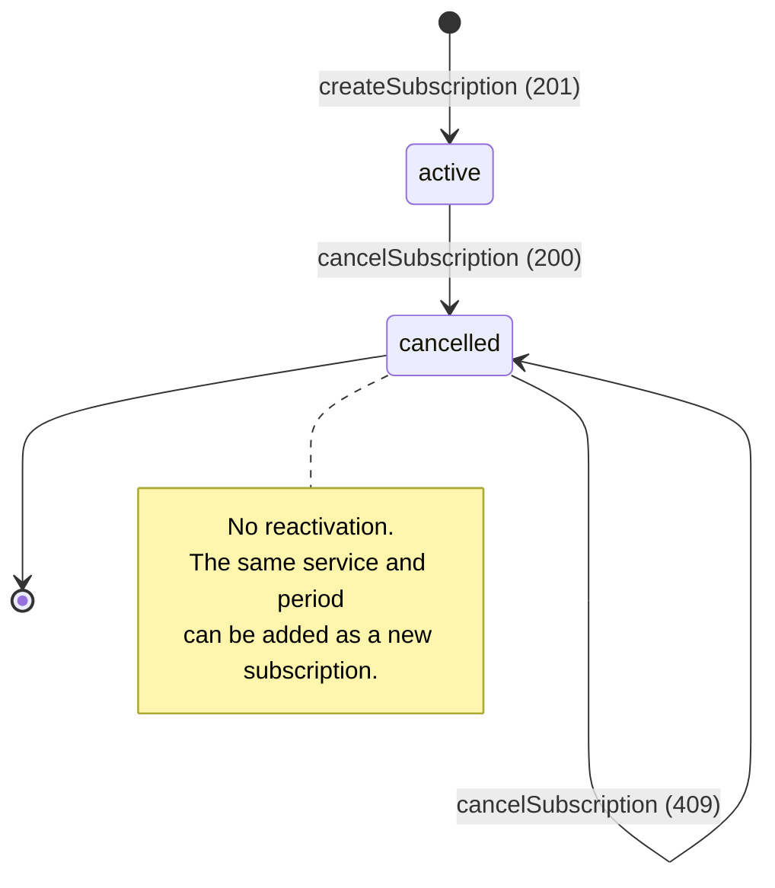
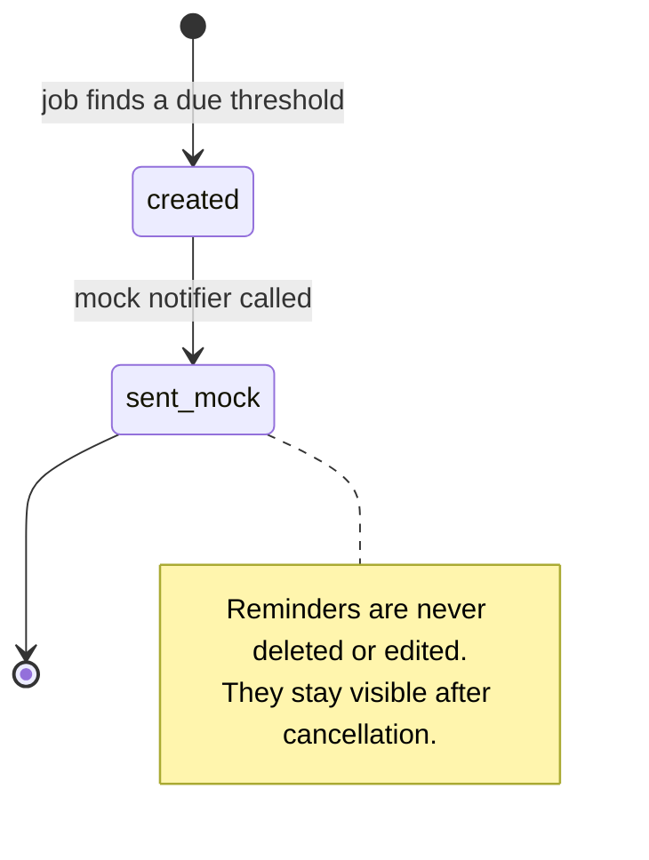

# Software Requirements Specification (SRS)

**Project:** Subscription Reminder Mobile Application
**Course:** BM 321 / SENG 321 · Software Engineering Project · Sprint 2 · Team 11
**Owner:** Zeynep Sude Develi (`zsudedeveli`), Product Owner and Requirements Engineer
**Version / date:** 2.0 · 17 November 2026 (supersedes version 1.0 of 31 October 2026)
**Applies decisions:** D-01 to D-27 in [decision-log.md](decision-log.md)
**Status:** Product Owner approved; peer review through pull request

| Related document | Purpose |
|---|---|
| [01-project-proposal.md](01-project-proposal.md) | Problem, stakeholders, feasibility, license |
| [02-system-vision-and-boundary.md](02-system-vision-and-boundary.md) | Vision, system boundary, scope |
| [06-product-backlog.md](06-product-backlog.md) | Prioritized stories, estimates, Sprint 3 plan |
| [07-nonfunctional-requirements.md](07-nonfunctional-requirements.md) | Quality requirements and measures |
| [08-user-flows-and-prototype-spec.md](08-user-flows-and-prototype-spec.md) | User flows, screens, Figma specification |
| [decision-log.md](decision-log.md) | Product decisions D-01 to D-27 |
| [../../api/openapi.yaml](../../api/openapi.yaml) | API contract (owned by the Lead Architect) |
| [../architecture/db-semasi.md](../architecture/db-semasi.md) | Database schema (owned by the Lead Architect) |
| [../adr/](../adr/) | Architecture decision records ADR-001 to ADR-004 |
| [../qa/test-plan.md](../qa/test-plan.md) | QA test plan and scenarios (`QA-*` identifiers) |

---

## 1. Introduction

### 1.1 Purpose

This document specifies, in testable detail, what the Subscription Reminder application shall do in its first release. It is written for the developers who implement it, the QA engineer who verifies it, the Architect who designs it, and the instructor who assesses it. Behaviour that is already fixed in the OpenAPI contract is repeated here only as far as needed to make a requirement testable; where the two documents differ, the contract and the architecture decision records are authoritative and the difference is a defect of this document (see section 5 for the escalation path).

### 1.2 Scope

The **Subscription Reminder** is an Android mobile application with a server. A user enters the subscriptions they pay for (service name, amount, monthly or yearly period, start date). The system calculates the next renewal date of each subscription and, **3 days and 1 day before every renewal**, creates a reminder that the user can see in the application. The first release uses a mock notifier: reminders are recorded and shown in the application, and no real push notification is sent.

**In scope (first release):** registration and login (email and password, JWT); adding, listing and viewing subscriptions; removing a subscription from tracking; renewal-date calculation; reminder generation by a daily job; read-only reminder list; session end on the device.

**Out of scope (first release, binding):** cancelling the real subscription at the provider; payments, bank or mailbox integration; real push notifications; weekly or custom periods; currencies other than TRY; snoozing reminders (US-10); invoices and bills (D-22); password reset; account deletion; iOS; multilingual interface; analytics and sharing. A request for any of these is recorded as a new backlog item and is not built without a Product Owner decision.

### 1.3 Definitions and abbreviations

| Term | Meaning |
|---|---|
| Subscription | A recurring paid service that the user tracks (for example Netflix, monthly). |
| Start date | Date of the **first charge**, entered by the user (D-16). |
| Period | `monthly` or `yearly`. |
| Renewal date | A date of the series *start date + k × period* (k ≥ 1). |
| Next renewal date | The earliest renewal date that is **after** today. Calculated, never stored. |
| Reminder | A record generated by the server for a given (subscription, renewal date, days before) with `daysBefore` 3 or 1. |
| `remindOn` | `renewalDate − daysBefore`; the day on which a reminder becomes due. |
| Catch-up | Making up, at a later daily run, a reminder that was due but missed (ADR-002). |
| Active / cancelled | Subscription status. *Cancelled* means "removed from tracking"; the real subscription is not affected (D-03). |
| Kuruş | 1/100 of a Turkish lira. All amounts are integers in kuruş (22999 = 229,99 TL). |
| Mock notifier | A notifier that records a reminder as `sent_mock` instead of sending a push message (D-07). |
| JWT | JSON Web Token used as the bearer token for authentication. |
| FR / UC / BR / UIR / NFR / AT | Functional requirement / use case / business rule / user-interface requirement / non-functional requirement / acceptance scenario. |

### 1.4 Document conventions

- **Identifiers are stable.** FR-01 to FR-13 keep the numbers they had in version 1.0. New requirements receive new numbers; a requirement is never renumbered or reused.
- **"Shall"** marks a binding requirement. **Priority** uses MoSCoW: *Must* (the release fails without it), *Should* (needed for a complete release), *Could* (wanted if time allows). The backlog uses P1 to P3 for stories; the mapping is Must = P1, Should = P2, Could = P3.
- **Verification** is one of *Test* (automated or manual test), *Demo* (shown on the running product), *Inspection* (review of a document or the code).
- HTTP status codes and error `code` values are those of `api/openapi.yaml`. User-visible texts are Turkish (D-19); this document is in English and quotes the Turkish text where the exact words matter.

### 1.5 Document overview

Section 2 describes the product and its context. Section 3 contains the specific requirements: use cases, functional requirements, interface requirements, data requirements, business rules, state models and the error catalogue. Section 4 is the traceability matrix. Section 5 lists open points and the change procedure. The quality requirements are in [07-nonfunctional-requirements.md](07-nonfunctional-requirements.md).

---

## 2. Overall description

### 2.1 Product perspective

The product is new and self-contained. It consists of three parts that run in a Docker Compose stack plus one client:

There is no integration with subscription providers, payment systems or push services (system boundary, [02-system-vision-and-boundary.md](02-system-vision-and-boundary.md)). The container and component views are in the architecture documents; they are not repeated here.

### 2.2 Product functions (summary)

| Group | Functions | Requirements |
|---|---|---|
| Account | Register, log in, protect all data, end the session | FR-01 to FR-03, FR-14 |
| Subscriptions | Add, validate, list, view, remove from tracking, prevent duplicates | FR-04, FR-05, FR-07 to FR-09 |
| Renewal | Calculate the next renewal date | FR-06 |
| Reminders | Generate two reminders per renewal, catch up, show them | FR-10 to FR-13 |
| Client behaviour | Amount entry, empty and error states, session expiry | FR-14, FR-15, UIR-01 to UIR-10 |

### 2.3 User classes and characteristics

| User class | Description | Needs |
|---|---|---|
| **End user** (the only human actor) | University students and young professionals with several digital subscriptions. In the pilot survey (14 responses) half had 3 to 5 subscriptions. Comfortable with a phone, not technical, enters data by hand. | See renewal dates at a glance; be warned before a charge; enter a subscription in under a minute; never believe that the real subscription was cancelled when it was not. |
| **Scheduler** (system actor) | The daily job inside the API. | Create due reminders exactly once, without user action. |

Developers, testers and operators are not users of the product and have no functions in the application.

### 2.4 Operating environment

- Client: Android phone, Android 10 or later (D-25), React Native with Expo.
- Server: Python 3 and FastAPI, PostgreSQL, one `docker compose up` (services `api` and `db`); the daily job runs inside the API process (APScheduler).
- Time: dates are calendar dates in Europe/Istanbul (fixed UTC+3); stored timestamps are UTC.

### 2.5 Design and implementation constraints

The constraints C1 to C9 of [02-system-vision-and-boundary.md](02-system-vision-and-boundary.md) apply unchanged. In particular: the API contract is owned by the Lead Architect and changes only through the Architect (C2); amounts are integer kuruş (C3); every error uses `{code, message}` and invalid input is always `400` (C6); test coverage is at least 50% (C7).

### 2.6 Assumptions and dependencies

| ID | Assumption or dependency |
|---|---|
| A1 | Users are willing to enter subscriptions manually (proposal A1). |
| A2 | Two reminders (3 and 1 day) are enough for users to react (proposal A2). |
| A3 | A mock notifier is acceptable for the course (proposal A3). |
| A6 | The device has network access to the API whenever the app is used; offline use is not required. |
| A7 | The daily job runs while the API is running. If it does not run, the next run catches up (FR-11). |
| D1 | The OpenAPI contract and ADR-001 to ADR-004 are stable. A change to either reopens the affected requirements. |

---

## 3. Specific requirements

### 3.1 Use cases

#### 3.1.1 Use-case list

| ID | Use case | Actor | Priority | Story | Requirements |
|---|---|---|---|---|---|
| UC-01 | Register an account | End user | Must | US-01 | FR-01 |
| UC-02 | Log in | End user | Must | US-02 | FR-02, FR-03 |
| UC-03 | Add a subscription | End user | Must | US-03, US-06, US-07 | FR-04, FR-05, FR-06, FR-15 |
| UC-04 | View the subscription list | End user | Must | US-04, US-07 | FR-03, FR-06, FR-07 |
| UC-05 | View one subscription | End user | Must | US-04 | FR-03, FR-08 |
| UC-06 | Remove a subscription from tracking | End user | Should | US-05 | FR-09, FR-12 |
| UC-07 | Generate reminders | Scheduler | Must | US-08 | FR-10, FR-11, FR-12 |
| UC-08 | View reminders | End user | Should | US-09 | FR-13 |
| UC-09 | End the session | End user | Should | US-11 | FR-14 |

#### 3.1.2 Use-case descriptions

**UC-01 · Register an account**

| Item | Description |
|---|---|
| Precondition | The user has no session and is on the authentication screen (S1). |
| Trigger | The user chooses "Kayıt Ol" with an email and a password. |
| Main flow | 1. The user enters email and password. 2. The app checks the format locally (UIR-04). 3. The app sends `registerUser`. 4. The server creates the account with a hashed password and returns `201`. 5. The app logs the user in (UC-02) or asks the user to log in. |
| Alternative flows | **A1** Invalid email, password shorter than 8 characters or a missing field: `400 VALIDATION_ERROR`; the message is shown, nothing is created. **A2** Email already registered (case-insensitive): `409 EMAIL_ALREADY_REGISTERED`; no second account. |
| Postcondition | One new account exists; the password is stored only as an argon2 hash. |
| Business rules | BR-11, BR-12 |

**UC-02 · Log in**

| Item | Description |
|---|---|
| Precondition | An account exists. |
| Trigger | The user submits email and password on S1. |
| Main flow | 1. The app sends `login`. 2. The server returns `200` with a JWT. 3. The app stores the token on the device and opens the subscription list (S2). |
| Alternative flows | **A1** Wrong password or unknown email: `401 INVALID_CREDENTIALS` with the **same** message in both cases. **A2** Malformed request: `400`. |
| Postcondition | The app holds a valid token (24 hours, ADR-004). |
| Business rules | BR-11 |

**UC-03 · Add a subscription**

| Item | Description |
|---|---|
| Precondition | The user is logged in. |
| Trigger | The user chooses the add button on S2 and opens the form (S4). |
| Main flow | 1. The user enters service name, amount (in TL), period and start date. 2. The app converts the amount to kuruş (FR-15) and sends `createSubscription`. 3. The server validates, stores the subscription with status `active`, calculates `nextRenewalDate` and returns `201`. 4. The app returns to the list, which shows the new subscription with its next renewal date. |
| Alternative flows | **A1** Missing or invalid field, amount 0 or negative, name longer than 100 characters, period other than `monthly`/`yearly`, start date outside the allowed range: `400`. **A2** An active subscription with the same service name (case-insensitive) and period already exists for this user: `409 SUBSCRIPTION_ALREADY_ACTIVE`; nothing is created. **A3** Token missing or expired: `401`; the app returns to S1 (UC-09 A1). |
| Postcondition | A new active subscription belongs to the user. The daily job will create its reminders (UC-07). |
| Business rules | BR-01 to BR-04, BR-08, BR-09, BR-10 |

**UC-04 · View the subscription list**

| Item | Description |
|---|---|
| Precondition | The user is logged in. |
| Trigger | The app opens S2, or the user refreshes it. |
| Main flow | 1. The app sends `listSubscriptions`. 2. The server returns the user's subscriptions, newest first, each with name, amount, period, next renewal date, status and its `reminders`. 3. The app shows one card per subscription. |
| Alternative flows | **A1** The user has no subscription: `200` with an empty list; the app shows the empty state (UIR-06). **A2** `401`: see UC-09 A1. |
| Postcondition | None (read-only). |
| Business rules | BR-01, BR-02, BR-07 |

**UC-05 · View one subscription**

| Item | Description |
|---|---|
| Precondition | The user is logged in and selects a subscription on S2. |
| Main flow | The app shows the details (S3) from the list data or by calling `getSubscription`. |
| Alternative flows | **A1** Unknown id or the id of another user's subscription: `404 NOT_FOUND`, never `403`. |
| Business rules | BR-07 |

**UC-06 · Remove a subscription from tracking**

| Item | Description |
|---|---|
| Precondition | The user is logged in and owns an **active** subscription. |
| Trigger | The user chooses "Takipten Çıkar". |
| Main flow | 1. The app shows the confirmation "Takipten çıkarılsın mı?" with the text "Servisteki gerçek aboneliğiniz iptal edilmez." 2. The user confirms. 3. The app sends `cancelSubscription`. 4. The server sets the status to `cancelled`, records `cancelledAt` and returns `200`. 5. The list shows the subscription as removed; its earlier reminders stay visible. |
| Alternative flows | **A1** The user dismisses the dialog: nothing is sent. **A2** Already cancelled: `409 ALREADY_CANCELLED`. **A3** Unknown or foreign id: `404`. |
| Postcondition | No new reminders are generated for this subscription. The same service and period may be added again. |
| Business rules | BR-05, BR-06, BR-07 |

**UC-07 · Generate reminders**

| Item | Description |
|---|---|
| Actor / trigger | The scheduler, every day at 09:00 Europe/Istanbul. |
| Main flow | 1. The job takes today's date. 2. For every **active** subscription it calculates the next renewal date. 3. For the 3-day and the 1-day threshold it checks whether `remindOn ≤ today` and `remindOn ≥` the day the subscription was added, and whether the renewal day has not arrived. 4. For each due threshold without an existing record it creates a reminder with status `sent_mock`. 5. It logs the number of reminders created. |
| Alternative flows | **A1** The job did not run on an earlier day: the next run makes up the missed reminder while the renewal day has not arrived (catch-up). **A2** The job runs twice on the same day: the database unique constraint prevents duplicates. **A3** The subscription is cancelled: it is skipped. |
| Postcondition | At most one reminder exists per (subscription, renewal date, daysBefore). |
| Business rules | BR-02, BR-04, BR-05, BR-06, BR-12 |

**UC-08 · View reminders**

| Item | Description |
|---|---|
| Precondition | The user is logged in. |
| Main flow | The app sends `listReminders` and shows the flat list (S5): newest `remindOn` first, then `daysBefore` ascending. The list of each subscription (S2/S3) shows the reminders of that subscription. |
| Alternative flows | **A1** No reminders yet: empty state (UIR-06). **A2** `401`: UC-09 A1. |
| Business rules | BR-07 |

**UC-09 · End the session**

| Item | Description |
|---|---|
| Trigger | **Main:** the user chooses "Çıkış Yap". **A1:** any call returns `401` because the token is missing, invalid or expired. |
| Main flow | The app deletes the stored token and shows S1. No server call is made. |
| Alternative flow | **A1** On `401` the app deletes the token, shows S1 and displays "Oturumunuz sona erdi. Lütfen tekrar giriş yapın." |
| Postcondition | No token remains on the device. |

### 3.2 Functional requirements

Every requirement has a priority, a verification method and the decision or story that justifies it. The texts of FR-01 to FR-13 are those of version 1.0; FR-14 and FR-15 are new in version 2.0.

| ID | Requirement | Priority | Verification | Source |
|---|---|---|---|---|
| FR-01 | A user shall register with email and password (minimum 8 characters). Valid input: `201`. Invalid input: `400`. Email already registered: `409`; no second account is created. | Must | Test | US-01 |
| FR-02 | A user shall log in with email and password: `200` with a JWT. Wrong password or unknown email: `401` with the same generic message. Malformed request: `400`. | Must | Test | US-02 |
| FR-03 | Every subscription and reminder operation shall require authentication (`401` otherwise). A user shall access only their own records; another user's record returns `404`, not `403`. | Must | Test | US-02, US-04 |
| FR-04 | A user shall create a subscription with: service name (required, 1–100 characters), amount (integer kuruş, greater than 0, TRY only), period (`monthly` or `yearly`), start date. Valid: `201`. Missing or invalid fields, zero or negative amount, weekly period: `400`. | Must | Test | US-03; D-05, D-16 |
| FR-05 | A second **active** subscription with the same service name (case-insensitive) and period for the same user shall be rejected with `409`. Removed (cancelled) records shall not block a new one. Uniqueness is per user. | Should | Test | US-06; D-04 |
| FR-06 | The system shall compute `nextRenewalDate` from the original start date: the earliest date of the series *start + k × period* (k ≥ 1) that is **after** today. A start date in the future therefore gives start + 1 period as the first renewal; if today is itself a renewal date, the next renewal is the following period. If the target month lacks the start day, the last day of that month is used (31 Jan → 28 Feb → 31 Mar). The date is always calculated from the original start date, never from the previous result (no drift). | Must | Test | US-07; D-06, D-16 |
| FR-07 | The subscription list shall return the user's subscriptions, newest first, each with a read-only `reminders` array (`daysBefore`, `remindOn`, `status`). Cancelled records are included with `status: cancelled`. | Must | Test | US-04; D-08 |
| FR-08 | A user shall view one subscription by id (`getSubscription`). Unknown or foreign id: `404`. | Must | Test | US-04; D-17 |
| FR-09 | A user shall remove a subscription from tracking (`POST /subscriptions/{id}/cancel`): status becomes `cancelled`, `200`. Already cancelled: `409`. Unknown or foreign: `404`. The interface shall state that the real provider subscription is **not** cancelled. | Should | Test, Demo | US-05; D-03 |
| FR-10 | A daily job at 09:00 Europe/Istanbul shall create at most one reminder per (subscription, renewal date, days before) for 3 and 1 days before renewal, with status `sent_mock`. Running it twice shall create no duplicates (database unique constraint). | Must | Test | US-08; D-01, D-07, D-11 |
| FR-11 | **Late addition and catch-up (ADR-002).** A reminder shall never be created for a date earlier than the day the subscription was added. A due reminder that was missed afterwards (the job did not run, or the subscription was added after 09:00 on its reminder date) shall be made up by the next daily run while the renewal day has not arrived. A subscription added after 09:00 on its 3-day date receives the 3-day reminder at the next run; one added after 09:00 on its 1-day date receives no catch-up for the 1-day reminder. At most one reminder exists per (subscription, renewal date, daysBefore). | Must | Test | US-08; D-02 |
| FR-12 | Cancelled subscriptions shall receive no new reminders; existing reminders shall remain visible. | Should | Test | US-05, US-08; D-09 |
| FR-13 | A user shall list their reminders as a flat, read-only list (`listReminders`), ordered by `remindOn` descending (newest first), then by `daysBefore` ascending. No create, delete, update or snooze operation exists. | Should | Test | US-09; D-08 |
| FR-14 | **Session end (new).** The client shall end a session by deleting the stored token; no server call is made. When any call returns `401`, the client shall delete the token, show the authentication screen and display "Oturumunuz sona erdi. Lütfen tekrar giriş yapın." | Should | Test, Demo | US-11; D-24 |
| FR-15 | **Amount entry (new).** The client shall accept the amount in lira with a decimal comma or point and at most two decimals, and shall convert it to integer kuruş without rounding (`229,99` → `22999`). An entry with more than two decimals, a negative value, zero or a non-number shall be rejected on the device with a Turkish message before any request is sent. Amounts are shown as `229,99 ₺`. | Must | Test, Demo | US-03; D-05, D-26 |

### 3.3 User-interface requirements

The screens, components, states and Turkish texts are specified in [08-user-flows-and-prototype-spec.md](08-user-flows-and-prototype-spec.md). The binding requirements are:

| ID | Requirement | Priority | Verification |
|---|---|---|---|
| UIR-01 | The application shall have five screens: S1 Sign in / register, S2 Subscription list, S3 Subscription detail, S4 Add subscription, S5 Reminders (D-23). | Must | Demo |
| UIR-02 | All user-visible text shall be Turkish (D-19). Error messages come from the server `message` field. | Must | Inspection, Demo |
| UIR-03 | The text of the removal dialog shall be exactly "Takipten çıkarılsın mı?" and "Servisteki gerçek aboneliğiniz iptal edilmez." The button shall be called "Takipten Çıkar", never "İptal Et" (D-03). | Must | Demo |
| UIR-04 | The client shall validate before sending: email format, password length of at least 8, non-empty service name of at most 100 characters, amount (FR-15), start date in the allowed range. The server remains the authority; client validation only saves a round trip. | Should | Test |
| UIR-05 | Every screen that loads data shall have a loading state, an error state with a retry action, and, where a list can be empty, an empty state. | Must | Demo |
| UIR-06 | The empty list of S2 shall show "Henüz abonelik eklemediniz." with an add button; the empty list of S5 shall show "Henüz hatırlatma yok." | Should | Demo |
| UIR-07 | Dates shall be shown as `DD.MM.YYYY`; the next renewal date shall be shown with the number of days left. | Should | Demo |
| UIR-08 | The add form shall show the currency as the fixed label "TRY" and shall not send it in the request. | Must | Inspection |
| UIR-09 | The removal action shall be reachable from S2 and S3 and shall be disabled for a subscription that is already removed. | Should | Demo |
| UIR-10 | The add-subscription flow shall be completable in under 60 seconds by a new user (NFR-U1). | Should | Usability test |

### 3.4 External interface requirements

#### 3.4.1 Software interface: the HTTP API

The API is the only interface of the server. It is defined in `api/openapi.yaml` (OpenAPI 3.0.3, seven operations). This table is a summary; the contract is authoritative.

| Operation | Method and path | Auth | Success | Error statuses | Requirement |
|---|---|---|---|---|---|
| `registerUser` | `POST /auth/register` | none | `201` | 400, 409 | FR-01 |
| `login` | `POST /auth/login` | none | `200` | 400, 401 | FR-02 |
| `createSubscription` | `POST /subscriptions` | bearer | `201` | 400, 401, 409 | FR-04, FR-05 |
| `listSubscriptions` | `GET /subscriptions` | bearer | `200` | 401 | FR-06, FR-07 |
| `getSubscription` | `GET /subscriptions/{id}` | bearer | `200` | 401, 404 | FR-08 |
| `cancelSubscription` | `POST /subscriptions/{id}/cancel` | bearer | `200` | 401, 404, 409 | FR-09 |
| `listReminders` | `GET /reminders` | bearer | `200` | 401 | FR-13 |

General behaviour: a method that is not defined for a defined path returns `405` with an `Allow` header; an undefined path returns `404`. The body of these two responses is not part of the contract; tests check the status code only. The health endpoint `GET /health` is an operational endpoint outside the contract.

#### 3.4.2 Other interfaces

| Interface | Requirement |
|---|---|
| User interface | Android, touch, portrait; see section 3.3. |
| Hardware | An Android phone. The server needs no special hardware. |
| Communications | JSON over HTTP; the bearer token is sent in the `Authorization` header. The local setup uses plain HTTP on `localhost:8000`; a deployed demonstration should use HTTPS (NFR-S6). |
| Database | PostgreSQL, accessed only by the API through SQLAlchemy; schema changes only through Alembic migrations. |
| Notification | The notifier is an internal interface with one implementation, the mock notifier, so that a real push provider can replace it later without changing the reminder rules (D-07). |

### 3.5 Data requirements

#### 3.5.1 Logical data model

The physical schema, constraints and indexes are in [../architecture/db-semasi.md](../architecture/db-semasi.md). The next renewal date is not stored; it is calculated (`backend/app/domain/renewal.py`).

#### 3.5.2 Data dictionary

| Entity | Field | Rule |
|---|---|---|
| User | `email` | Valid format, at most 254 characters, stored in lower case, unique. |
| User | `password` | At least 8 characters on input; stored only as an argon2 hash. |
| Subscription | `serviceName` | Trimmed, 1–100 characters. |
| Subscription | `amountKurus` | Integer, at least 1; currency fixed to TRY. |
| Subscription | `period` | `monthly` or `yearly`. |
| Subscription | `startDate` | `YYYY-MM-DD`; date of the first charge; from 2000-01-01 up to 366 days after today. |
| Subscription | `status` | `active` or `cancelled`; `cancelledAt` is set when cancelled. |
| Reminder | `daysBefore` | 3 or 1. |
| Reminder | `remindOn` | `renewalDate − daysBefore`. |
| Reminder | `status` | `created` (generated) or `sent_mock` (mock notification sent). |

#### 3.5.3 Data handling

- **Personal data:** only the email address (and its password hash) is personal data. No card, bank, location or contact data is collected (NFR-S4).
- **Retention:** cancelled subscriptions and all reminders are kept; rows are not deleted. Account deletion is out of scope and recorded as release risk R7 in the proposal.
- **Volume assumption:** a user tracks up to about 100 subscriptions; the system is sized for 1,000 users in the demonstration (NFR-P1, NFR-P3).

### 3.6 Business rules

| ID | Rule | Requirement | Decision |
|---|---|---|---|
| BR-01 | Amounts are integers in kuruş; the only currency is TRY. | FR-04, FR-15 | D-05 |
| BR-02 | Renewal dates are calculated from the original start date; the first renewal is one period after the start date (k ≥ 1); if today is a renewal date the next period is used. | FR-06 | D-06, D-16 |
| BR-03 | If the target month lacks the start day, the last day of the month is used (31 Jan → 28 Feb → 31 Mar; 29 Feb → 28 Feb in non-leap years). | FR-06 | D-06 |
| BR-04 | Two reminders per renewal: 3 days and 1 day before, each created at most once per (subscription, renewal date, daysBefore). | FR-10, FR-11 | D-01 |
| BR-05 | A reminder is never created for a date before the day the subscription was added; a missed due reminder is made up at the next run while the renewal day has not arrived. | FR-11 | D-02, ADR-002 |
| BR-06 | "Cancel" means removal from tracking; no new reminders afterwards; earlier reminders remain; the same service and period may be added again. | FR-09, FR-12 | D-03, D-09 |
| BR-07 | A record of another user is reported as `404`, never `403`. All queries are filtered by the authenticated user. | FR-03, FR-08 | – |
| BR-08 | Duplicate rule: same user, same service name (case-insensitive) and same period, **active** records only. | FR-05 | D-04 |
| BR-09 | Allowed periods: `monthly`, `yearly`. Any other value is `400`. | FR-04 | D-05 |
| BR-10 | The start date must be between 2000-01-01 and 366 days after today. | FR-04 | D-16 |
| BR-11 | A failed login never reveals whether the email exists (same message for wrong password and unknown email). | FR-02 | – |
| BR-12 | The daily job runs at 09:00 Europe/Istanbul and is idempotent. | FR-10 | D-11 |

### 3.7 State models

### 3.8 Error catalogue

All errors use `{ "code": "...", "message": "..." }` (C6). Invalid input is always `400`.

| HTTP | `code` | Raised when | Example Turkish message |
|---|---|---|---|
| 400 | `VALIDATION_ERROR` | Missing field, format error, zero or negative amount, name too long, unsupported period, date outside the allowed range, password too short | `amountKurus sıfırdan büyük olmalıdır.` |
| 401 | `INVALID_CREDENTIALS` | Wrong email or password at login | `E-posta veya şifre hatalı.` |
| 401 | `UNAUTHORIZED` | Token missing, invalid or expired | `Geçerli bir oturum gerekli.` |
| 404 | `NOT_FOUND` | Unknown id, or a record of another user | `Abonelik bulunamadı.` |
| 409 | `EMAIL_ALREADY_REGISTERED` | Registration with an existing email | `Bu e-posta ile kayıtlı bir hesap var.` |
| 409 | `SUBSCRIPTION_ALREADY_ACTIVE` | Duplicate active subscription | `Bu servis ve periyot için aktif bir abonelik zaten var.` |
| 409 | `ALREADY_CANCELLED` | Cancelling a cancelled subscription | `Bu abonelik zaten iptal edilmiş.` |
| 405 / 404 | not specified | Undefined method or path | status code only |

---

## 4. Verification and traceability

### 4.1 Traceability matrix

The matrix links each requirement to its use case, story and GitHub issue, API operation, screen, acceptance scenarios (`AT-nn`, Product Owner identifiers), QA scenario family (`QA-*`, [QA test cases](../qa/test-cases.md)) and the quality requirements that constrain it. The **Evidence** column is filled with the link of the merged pull request or the test run as work is completed. "Sprint 3" means that nothing is implemented yet and the work is planned for Sprint 3; the cell is not filled in advance, because documented is not implemented, and implemented is not tested.

| Requirement | Use case | Story / issue | API operation | Screen | Acceptance | QA scenarios | Related NFR | Evidence |
|---|---|---|---|---|---|---|---|---|
| FR-01 | UC-01 | US-01 / #9 | `registerUser` | S1 | AT-01 to AT-03 | QA-AUTH-* | NFR-S1, NFR-S2 | Sprint 3 |
| FR-02 | UC-02 | US-02 / #10 | `login` | S1 | AT-04 to AT-06 | QA-AUTH-* | NFR-S1, NFR-S3 | Sprint 3 |
| FR-03 | UC-02, UC-04, UC-05 | US-02 / #10, US-04 / #12 | all protected operations | all | AT-07, AT-10, AT-11, AT-28 | QA-AUTH-* | NFR-S3 | Sprint 3 |
| FR-04 | UC-03 | US-03 / #11 | `createSubscription` | S4 | AT-08, AT-09 | QA-SUB-* | NFR-P1, NFR-U1 | Sprint 3 |
| FR-05 | UC-03 | US-06 / #14 | `createSubscription` (409) | S4 (error) | AT-12 to AT-15 | QA-SUB-* | NFR-R3 | Sprint 3 |
| FR-06 | UC-03, UC-04, UC-07 | US-07 / #15 | domain logic; shown in create and list | S2, S3 | AT-18 to AT-21 | QA-DATE-* | NFR-R3, NFR-M2 | Domain function and unit tests: PR #4. API integration: Sprint 3 |
| FR-07 | UC-04 | US-04 / #12 | `listSubscriptions` | S2 | AT-11 | QA-SUB-* | NFR-P1 | Sprint 3 |
| FR-08 | UC-05 | US-04 / #12 | `getSubscription` | S3 | AT-10 | QA-SUB-* | NFR-P1 | Sprint 3 |
| FR-09 | UC-06 | US-05 / #13 | `cancelSubscription` | S2, S3 (dialog) | AT-16, AT-17 | QA-SUB-* | NFR-U4 | Sprint 3 |
| FR-10 | UC-07 | US-08 / #16 | scheduled job | S2 (badges), S5 | AT-22 to AT-24, AT-27 | QA-REM-* | NFR-R1, NFR-P3 | Pure rule and unit tests: PR #32. Daily job: Sprint 3 |
| FR-11 | UC-07 | US-08 / #16 | scheduled job | n/a | AT-25, AT-30 | QA-REM-* | NFR-R1, NFR-R2 | Pure rule and unit tests (AT-25, AT-30): PR #32. Daily job: Sprint 3 |
| FR-12 | UC-06, UC-07 | US-05 / #13, US-08 / #16 | `cancelSubscription`, job | S2, S3 | AT-26 | QA-REM-* | – | Sprint 3 |
| FR-13 | UC-08 | US-09 / #17 | `listReminders` | S5 | AT-28, AT-29 | QA-REM-* | NFR-P1 | Sprint 3 |
| FR-14 | UC-09 | US-11 | none (client only) | S1 | AT-31, AT-32 | (to be added by QA) | NFR-S5 | Sprint 3 |
| FR-15 | UC-03 | US-03 / #11 | `createSubscription` | S4 | AT-33, AT-34 | (to be added by QA) | NFR-U1 | Sprint 3 |

Acceptance scenario identifiers AT-01 to AT-34 are defined in [06-product-backlog.md](06-product-backlog.md). The QA test plan uses its own identifiers (`QA-*`); QA maps each `AT` to its `QA` scenarios in the test cases. AT-31 to AT-34 are new in version 2.0.

### 4.2 Coverage check

| Check | Result |
|---|---|
| Every story US-01 to US-09 has at least one FR and one UC | Yes (matrix above) |
| Every API operation is used by at least one FR | Yes (section 3.4.1) |
| Every FR has an acceptance scenario | Yes |
| Every screen S1 to S5 is reached by at least one UC | Yes ([08-user-flows-and-prototype-spec.md](08-user-flows-and-prototype-spec.md) section 3) |

---

## 5. Open points and change procedure

### 5.1 Open points

| # | Point | Owner | Due |
|---|---|---|---|
| 1 | The Architect confirms that FR-14 and FR-15 need no contract change (both are client-side) and that the five-screen structure (D-23) is acceptable for the mobile skeleton (T-05). | Architect | Sprint 2 review |
| 2 | QA adds `QA-*` scenarios for AT-31 to AT-34 and maps every `AT` to a `QA` scenario. | QA | Sprint 3 planning |
| 3 | The Implementation engineer confirms the minimum Android version (D-25) against the Expo SDK in use. | Implementation | Sprint 3 planning |
| 4 | The Evidence column of section 4.1 is filled as pull requests merge. | PO | Sprint 3, continuous |

### 5.2 Change procedure

1. A change to a requirement starts as a GitHub issue that names the requirement identifier.
2. If the change touches an API operation, a field, an error code or a status code, the Lead Architect changes the contract first (contract before code) and the Product Owner approves the behaviour.
3. The Product Owner records the decision in the decision log and updates this document; the version number and date in the header change; identifiers are not reused.
4. QA updates the affected scenarios; the traceability matrix is updated in the same pull request.
