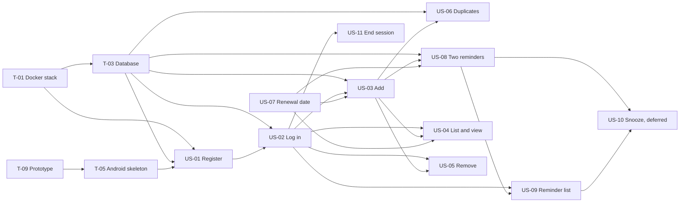

# Product Backlog

**Project:** Subscription Reminder Mobile Application
**Owner:** Zeynep Sude Develi (`zsudedeveli`), Product Owner and Requirements Engineer
**Version / date:** 2.0 · 17 November 2026 · Sprint 2 baseline (supersedes version 1.0 of 31 October 2026)
**Source of truth for live state:** GitHub issues and the milestones `Sprint-1`, `Sprint-2`, `Sprint-3`. This file is the refined baseline of Sprint 2; the *Status* column is updated at every sprint planning and review.

Related documents: [SRS](03-requirements.md) · [Non-functional requirements](07-nonfunctional-requirements.md) · [User flows and prototype specification](08-user-flows-and-prototype-spec.md) · [Decision log](decision-log.md)

## 1. How to read this backlog

- **Hierarchy:** Epic → Feature → Story → Task.
- **Priority:** P1 = needed for the core value of the first release (SRS *Must*); P2 = needed for a complete first release (*Should*); P3 = deferred (*Could*). GitHub labels: `priority-1`, `priority-2`, `priority-3`.
- **Estimate:** story points on the Fibonacci scale (1, 2, 3, 5, 8). These are the PO's **initial** estimates. The team confirms or changes them in planning poker at sprint planning (decision D-15); a story above 8 points is split before it enters a sprint.
- **Owner:** the person *proposed* to implement. Final assignment is made by the team at sprint planning. QA owns the verification of every story.
- **Status:** *Done* (meets the Definition of Done), *In progress*, *Ready* (meets the Definition of Ready, not started), *Not started*, *Deferred*.
- **Traceability:** every story points to its requirements (FR), use cases (UC), screens (S) and acceptance scenarios (AT); the full matrix is in section 4.1 of the [SRS](03-requirements.md).
- **Definition of Ready** and **Definition of Done** are in section 7.

## 2. Release plan

| Stage | Dates | Goal | Backlog content |
|---|---|---|---|
| Sprint 1 (done) | 22 Oct – 5 Nov 2026 | Foundation | Proposal, vision, OpenAPI draft, roles, Git-Flow, initial backlog; tasks T-01 to T-04, T-06 |
| **Sprint 2** | 6 Nov – 24 Nov 2026 (submission deadline 24 Nov, set by the instructor) | Specification and design | SRS, NFRs, refined backlog, Figma prototypes and user flows, C4 and UML, Android skeleton (T-05) |
| Sprint 3 | 27 Nov – 17 Dec 2026 | First working MVP | Stories US-01 to US-09 and US-11 with CI and at least 50% coverage |
| Final | 18 – 31 Dec 2026 | Live product | Docker one-command start, integration and end-to-end tests, SonarQube, demonstration |

## 3. Epics and features

| Epic | Value | Features | Stories and tasks |
|---|---|---|---|
| **E1 · Account and access** | Users keep private data and nobody else can see it. | F1.1 Register · F1.2 Log in and protect endpoints · F1.3 End the session | US-01, US-02, US-11 |
| **E2 · Subscription management** | Users keep one correct list of their subscriptions. | F2.1 Add and validate · F2.2 View · F2.3 Remove from tracking · F2.4 Renewal date | US-03, US-04, US-05, US-06, US-07 |
| **E3 · Renewal reminders** | Users are warned before each renewal. | F3.1 Reminder generation · F3.2 Reminder visibility · F3.3 Snooze (deferred) | US-08, US-09, US-10 |
| **E4 · Engineering foundation (enablers)** | The team can build, test and deliver with evidence. | F4.0 Docker stack · F4.1 CI and rulesets · F4.2 Database · F4.3 Test plan · F4.4 Mobile skeleton · F4.5 Process calendar · F4.6 Repository hygiene | T-01 to T-06, T-13 |
| **E5 · Specification and design (Sprint 2)** | The team builds the right thing, and the design is agreed before the MVP. | F5.1 Requirements specification · F5.2 Quality requirements · F5.3 UI/UX prototypes and user flows · F5.4 Architecture documentation | T-07 to T-12 |

## 4. Prioritized user stories

Order of work (top first). Dependencies follow the Architect's dependency comments on the issues. They use story and task identifiers; other prerequisites are named in words.

| Rank | ID | Issue | Story | Epic | Priority | Points | Depends on | Screens | Proposed owner | Status |
|---:|---|---|---|---|---|---:|---|---|---|---|
| 1 | US-01 | #9 | As a new user, I can register with email and password so that I have a private account. | E1 | P1 | 3 | T-01, T-03 | S1 | Implementation (Emre Alay) | Ready |
| 2 | US-02 | #10 | As a registered user, I can log in so that I can reach my own data, and unauthenticated requests are refused. | E1 | P1 | 5 | US-01, T-03 | S1 | Implementation (Emre Alay) | Ready |
| 3 | US-03 | #11 | As a user, I can add a subscription (service, amount in TL, period, start date) so that it is tracked. | E2 | P1 | 3 | US-02, US-07, T-03 | S4 | Implementation (Emre Alay) | Ready |
| 4 | US-07 | #15 | As a user, I see the correct next renewal date of each subscription, including month-end and leap-year cases. | E2 | P1 | 5 | none (pure function) | S2, S3 | Architect (ybyaman) + QA | In progress: domain function and tests merged (PR #4); integration with the API pending |
| 5 | US-04 | #12 | As a user, I can see my list of subscriptions and open one subscription to view its details. | E2 | P1 | 5 | US-02, US-03, US-07 | S2, S3 | Implementation (Emre Alay) | Ready |
| 6 | US-08 | #16 | As a user, I receive a reminder 3 days and 1 day before each renewal, once each. | E3 | **P1** (raised from P2, D-14) | 8 | US-03, US-07, T-03 | S2, S5 | Architect (ybyaman) | In progress: slice 1 merged (PR #32); slice 2 pending (see 4.2) |
| 7 | US-05 | #13 | As a user, I can remove a subscription from tracking and I am told the real subscription is not cancelled. | E2 | P2 | 3 | US-02, US-03 | S2, S3 | Implementation (Emre Alay) | Ready |
| 8 | US-06 | #14 | As a user, I cannot create the same active subscription twice. | E2 | P2 | 2 | US-03, T-03 | S4 | Implementation (Emre Alay) | Ready |
| 9 | US-09 | #17 | As a user, I can see a read-only list of my reminders. | E3 | P2 | 3 | US-02, US-08 | S5 | Architect (ybyaman) | Ready |
| 10 | US-11 | #69 | As a user, I can log out, and I am taken back to the sign-in screen when my session expires, so that nobody else can use my data on my phone. | E1 | P2 | 2 | US-02 | S1 | Implementation (Emre Alay) | Ready |
| – | US-10 | #18 | As a user, I can snooze a reminder. | E3 | P3 (deferred) | 3 | US-08, US-09 | – | Not in first release | Deferred |

**Total for stories in the first release (US-01 … US-09 and US-11): 39 points** (37 points in version 1.0 plus US-11). US-10 is excluded.

### 4.1 Why US-08 is P1

The two-reminder feature is the core value of the product (the hypothesis in the proposal). Without it, the application is only a list. US-06 stays P2: the system works without duplicate protection, but the data is cleaner with it.

### 4.2 Refinement of large and partly delivered stories

**US-08 (8 points) is delivered in two vertical slices** that are tracked as a checklist in issue #16. Slice 1 is already merged; slice 2 remains.

| Slice | Content | Points | Status |
|---|---|---:|---|
| US-08a | Pure rule `due_reminders`: which reminders are due for a subscription on a given day, including late addition and catch-up (ADR-002); unit tests AT-22 to AT-27, AT-30 | 3 | Done (PR #32) |
| US-08b | Daily job at 09:00 Europe/Istanbul: reads active subscriptions, calls the rule, stores reminders with status `sent_mock` through the mock notifier, idempotent, logs the count (NFR-R1, NFR-D3) | 5 | Not started |

**Action:** issue #16 was closed when the pull request of slice 1 merged. By the Definition of Done the story is not finished, so the Architect re-opens #16 (or opens a child issue "US-08b") before Sprint 3 planning, so that the board shows the real state.

**US-07 (5 points)** has its pure function and tests merged (PR #4). What remains is showing the date through the API (`createSubscription`, `listSubscriptions`, `getSubscription`) and in the screens; this is done inside US-03 and US-04, and US-07 is closed when AT-18 to AT-21 pass through the API.

### 4.3 Sprint 3 proposal (to be confirmed at sprint planning)

The Product Owner proposes the order and the cut line; the team decides the commitment from its capacity (D-15). Implementation capacity is the main constraint (risk R1 of the proposal): backend stories are shared between the Architect and the Implementation engineer.

| Group | Stories | Points |
|---|---|---:|
| **Commit line (core value, must be in the MVP)** | US-01, US-02, US-03, US-07, US-04, US-08 | 29 |
| **Next (complete first release)** | US-05, US-06, US-09, US-11 | 10 |
| Total | | 39 |

If capacity is lower than 39 points, the stories below the commit line move to the final sprint in the order US-05, US-09, US-06, US-11. The commit line already gives a demonstrable journey: register, log in, add, see renewal date and receive reminders.

## 5. Acceptance criteria

Criteria are written so that QA can derive tests directly. `AT-nn` is the identifier of an acceptance scenario of this backlog. The QA test plan (T-04, `docs/qa/`) uses its own `QA-*` identifiers; QA maps each `AT` to its `QA` scenarios. A line that begins with *Screen* is a user-interface criterion (the screens are specified in [08-user-flows-and-prototype-spec.md](08-user-flows-and-prototype-spec.md)).

### US-01 · Register (#9) — FR-01 · UC-01 · S1
- Valid email and password of at least 8 characters → `201`, account created, password stored hashed. (AT-01)
- Invalid email, password shorter than 8 characters, or missing field → `400` with `{code, message}`. (AT-02)
- Email already registered (case-insensitive) → `409`, no second account. (AT-03)
- Screen: the server message is shown under the form; the register button is disabled while the request runs.

### US-02 · Log in (#10) — FR-02, FR-03 · UC-02 · S1
- Valid credentials → `200` with a JWT. (AT-04)
- Wrong password and unknown email → `401` with the **same** message. (AT-05)
- Malformed body → `400`. (AT-06)
- `GET /subscriptions`, `POST /subscriptions`, `GET /reminders` without a token → `401`. (AT-07)
- Screen: after login the subscription list (S2) opens; the token is stored in secure storage.

### US-03 · Add subscription (#11) — FR-04, FR-15 · UC-03 · S4
- Netflix, 22999 kuruş, monthly, valid start date → `201` and `nextRenewalDate` is returned. (AT-08)
- Amount 0 or negative, empty name, name of 101 characters, `weekly` period, missing start date, start date outside the allowed range → `400`. (AT-09)
- Screen: the amount is typed in lira (`229,99` or `229.99`) and sent as `22999`. (AT-33)
- Screen: an amount with more than two decimals, zero, negative or not a number is rejected on the device and nothing is sent. (AT-34)
- Screen: after saving, the list shows the new subscription with its next renewal date.

### US-04 · List and view subscriptions (#12) — FR-03, FR-07, FR-08 · UC-04, UC-05 · S2, S3
- The list contains only the caller's subscriptions with name, amount, period, next renewal date and a `reminders` array. (AT-11)
- `GET /subscriptions/{id}` of another user's subscription or an unknown id → `404`, not `403`. (AT-10)
- Screen: an empty list shows "Henüz abonelik eklemediniz." with an add button.
- Screen: a card shows the next renewal date and the days left; removed subscriptions are visibly marked.

### US-05 · Remove from tracking (#13) — FR-09, FR-12 · UC-06 · S2, S3
- Cancel an active owned subscription → `200`, status `cancelled`. The interface shows the warning that the provider subscription is not cancelled. (AT-16)
- Cancel twice → `409`; unknown or foreign id → `404`. (AT-17)
- After removal no new reminders are created; earlier reminders stay visible. (AT-26)
- Screen: the button is "Takipten Çıkar"; the dialog reads "Takipten çıkarılsın mı?" and "Servisteki gerçek aboneliğiniz iptal edilmez."

### US-06 · Prevent duplicates (#14) — FR-05 · UC-03 · S4
- Active "Netflix / monthly" exists; adding "netflix / monthly" → `409`, nothing created. (AT-12)
- Same service with period `yearly` → `201`. (AT-13)
- Another user adds the same service and period → `201`. (AT-14)
- After removal, the same service and period can be added again → `201`. (AT-15)
- Screen: the `409` message is shown on the form and the entered data is kept.

### US-07 · Renewal date (#15) — FR-06 · UC-03, UC-04
- Monthly, start 31 Jan 2027 → 28 Feb 2027, then 31 Mar 2027. (AT-18)
- Monthly, start 31 Jan 2028 (leap year) → 29 Feb 2028, then 31 Mar 2028. (AT-19)
- Yearly, start 29 Feb 2028 → 28 Feb 2029, 2030, 2031, then 29 Feb 2032. (AT-20)
- Monthly, start 31 Jan, consecutive months → 31 Mar, 30 Apr, 31 May (no drift). (AT-21)
- If today is a renewal date, the next renewal date is the following period (not today).
- If the start date is in the future, the first renewal date is the start date plus one period.

### US-08 · Two reminders (#16) — FR-10, FR-11, FR-12 · UC-07 · S2, S5
- Job on `renewalDate − 3` → one 3-day reminder with status `sent_mock`. (AT-22)
- Job on `renewalDate − 1` → one 1-day reminder. (AT-23)
- Job run twice for the same date → no duplicate rows. (AT-24)
- Subscription added 2 days before renewal → only the 1-day reminder. (AT-25)
- Cancel, then run the job in the reminder window → no new reminder. (AT-26)
- After the renewal date passes the next cycle gets its own two reminders. (AT-27)
- If the job did not run on a reminder date, the next run makes up the missed reminder while the renewal day has not arrived (ADR-002).
- Subscription added after 09:00 on its **3-day** date → the 3-day reminder is made up at the next job run; added after 09:00 on its **1-day** date → no catch-up for the 1-day reminder (ADR-002). Thresholds dated before the subscription was added are never created. (AT-30)

### US-09 · Reminder list (#17) — FR-13 · UC-08 · S5
- Only the caller's reminders, newest `remindOn` first; unauthenticated call → `401`. (AT-28)
- `POST`, `PUT`, `PATCH` and `DELETE` on `/reminders` are not offered (`405`). (AT-29)
- Screen: each entry shows the service name, "N gün kala" and the date; an empty list shows "Henüz hatırlatma yok."

### US-10 · Snooze (#18) — deferred
- Out of scope for the first release. No acceptance criteria are committed.

### US-11 · End the session — FR-14 · UC-09 · S1 (new)
- The user chooses "Çıkış Yap": the stored token is deleted, S1 is shown, and the back button does not return to the list. No server call is made. (AT-31)
- Any call returns `401` (token missing, invalid or expired): the token is deleted, S1 is shown and the message "Oturumunuz sona erdi. Lütfen tekrar giriş yapın." appears. (AT-32)

## 6. Tasks (enablers)

### 6.1 Sprint 1 tasks (status)

| ID | Issue | Task | Epic | Points | Depends on | Proposed owner | Status |
|---|---|---|---|---:|---|---|---|
| T-01 | #19 | Docker Compose stack (API and database) | E4 | 3 | none | DevOps (AhmeTalhAkyol) | Done |
| T-02 | #20 | CI checks and repository ruleset (GitHub Actions: ruff, pytest, Spectral OpenAPI lint; required checks `backend-test` and `openapi-lint`) | E4 | 3 | Backend skeleton pull request merged; CI workflow has run | Architect (ybyaman) | Done |
| T-03 | #21 | Database schema and Alembic migration on PostgreSQL (users, subscriptions with partial unique index on active rows, reminders with unique constraint) | E4 | 3 | Backend skeleton, T-01, ADR-003 | DevOps (AhmeTalhAkyol) | Done |
| T-04 | #22 | QA test plan and acceptance test suite (`docs/qa/`) | E4 | 3 | OpenAPI pull request merged; PO approval of the backlog | QA (nadirtaskiran) | Done (plan); automated suite continues in Sprint 3 |
| T-05 | #23 | Android application skeleton in React Native with Expo (screens and API client from the contract) | E4 | 5 | OpenAPI contract; screen designs (T-09) | Implementation (Emre Alay) | In progress, moved to Sprint 2 (screen drafts: PR #34) |
| T-06 | #24 | Scrum Master sprint calendar and ceremonies | E4 | 1 | none | Scrum Master (ynessakar) | Done |

### 6.2 Sprint 2 tasks (milestone `Sprint-2`, due 24 November 2026)

The issues T-07 to T-13 (#57 to #63) were created on 18 November 2026 and belong to milestone `Sprint-2`.

| ID | Issue | Task | Epic | Points | Depends on | Proposed owner | Deliverable |
|---|---|---|---|---:|---|---|---|
| T-07 | #57 | Software Requirements Specification and refined backlog | E5 | 5 | Vision, ADRs, OpenAPI | PO (Zeynep) | `03-requirements.md`, `06-product-backlog.md` |
| T-08 | #58 | Non-functional requirements and quality-measure specification | E5 | 3 | T-07; Architect, QA and DevOps consulted | PO (Zeynep) | `07-nonfunctional-requirements.md` |
| T-09 | #59 | Figma UI/UX prototype and user-flow diagrams | E5 | 5 | T-07; `08-user-flows-and-prototype-spec.md` | PO (Zeynep) draws; Implementation reviews feasibility | Figma file (view link) and `08-user-flows-and-prototype-spec.md` |
| T-10 | #60 | C4 model (levels 1 to 3) and UML architecture document | E5 | 8 | ADR-001 to ADR-004, database schema, T-07 | Architect (ybyaman) | `docs/architecture/` |
| T-11 | #61 | Usability test of the prototype with 5 users | E5 | 2 | T-09 | PO (Zeynep) with QA | `docs/qa/usability-test-sprint-2.md` |
| T-12 | #62 | Sprint 2 submission file, evidence and tag `sprint2` | E5 | 1 | T-07 to T-11, T-13 | Scrum Master (ynessakar), DevOps (AhmeTalhAkyol) | `docs/SPRINT-2-SUBMISSION.md`, release `sprint2` |
| T-13 | #63 | Repository hygiene: merge `develop` into `main` without rewriting history, correct the Sprint 1 tag link | E4 | 2 | none | DevOps (AhmeTalhAkyol), Architect | `main` equals the reviewed `develop`; tags `sprint1` and `sprint2` documented |

**Sprint 2 total: 26 points for T-07 to T-13, plus T-05 (5 points), 31 points in all.** These tasks are mostly documents; their size is an estimate of effort for planning, not a measure of velocity for the MVP.

## 7. Definitions

### Definition of Ready (a story may enter a sprint when…)
- The user, capability and value are explicit.
- Acceptance criteria are testable and cover the main behaviour and the main failures.
- Dependencies and API impact are understood and the contract already contains the operation.
- The screen it uses is designed in the prototype (from Sprint 3 on).
- The item is small enough to finish in one sprint (at most 8 points).
- Unresolved questions have an owner and a date.

### Definition of Done (a story is done when…)
- The code is in a pull request that links the issue and has been reviewed by someone other than the author.
- The acceptance criteria are verified by automated tests that pass in CI.
- The behaviour matches `api/openapi.yaml` (or the contract is changed through the Architect).
- Test coverage is at least 50% and no required check fails (NFR-M1, NFR-M3).
- The affected non-functional targets are met or the deviation is recorded (NFR document).
- Evidence (pull request, test run) is linked in the traceability matrix.
- The issue is closed **only** when all of the above hold.

### Definition of Ready check (Sprint 3 candidates)

| Story | Value clear | Testable criteria | Contract has the operation | Screen designed | ≤ 8 points | Open questions | Ready |
|---|---|---|---|---|---|---|---|
| US-01 | yes | yes (AT-01..03) | yes | yes (S1) | yes | none | **yes** |
| US-02 | yes | yes (AT-04..07) | yes | yes (S1) | yes | none | **yes** |
| US-03 | yes | yes (AT-08, 09, 33, 34) | yes | yes (S4) | yes | none | **yes** |
| US-04 | yes | yes (AT-10, 11) | yes | yes (S2, S3) | yes | none | **yes** |
| US-05 | yes | yes (AT-16, 17, 26) | yes | yes (dialog) | yes | none | **yes** |
| US-06 | yes | yes (AT-12..15) | yes | yes (S4 error) | yes | none | **yes** |
| US-07 | yes | yes (AT-18..21) | yes | yes (S2, S3) | yes | none | **yes** |
| US-08 | yes | yes (AT-22..27, 30) | yes | yes (S2, S5) | yes (split) | #16 state (see 4.2) | **yes** after #16 is re-opened |
| US-09 | yes | yes (AT-28, 29) | yes | yes (S5) | yes | none | **yes** |
| US-11 | yes | yes (AT-31, 32) | no API needed | yes (S1) | yes | none | **yes** |

## 8. Dependency overview

## 9. Changes against version 1.0

| Change | Reason |
|---|---|
| US-11 (end the session) added; FR-14 | A mobile app with sign-in needs a way to sign out and to handle an expired token (D-24). |
| FR-15 and UI criteria added to US-03 (AT-33, AT-34) | The contract takes kuruş; users type lira (D-26). |
| Screen criteria added to US-01 to US-09; screens column added | The prototype (T-09) and the stories must agree (D-23). |
| US-08 split into slices US-08a and US-08b; issue #16 to be re-opened | Slice 1 is merged but the story is not done; avoids a "giant story" and a false "done". |
| Status column and Sprint 3 proposal (commit line 29 points, next 10 points) added | Backlog is current and shows what is delivered. |
| Sprint 2 tasks T-07 to T-13 added; T-05 moved to Sprint 2 | Sprint 2 deliverables and the repository clean-up are tracked as work items. |
| Definition of Ready now requires the screen to be designed; Definition of Done requires the NFR targets | Aligns the definitions with the prototype and the quality requirements. |
| Dependency diagram extended with T-05, T-09, US-11 | Reflects the new work. |
| Story points of version 1.0 are unchanged | The team confirms or changes them at Sprint 3 planning poker (D-15). |

Changes of earlier drafts that are still valid: US-08 is P1 (D-14); the single-subscription view belongs to US-04 (D-17); owners follow the Architect's comments and the GitHub assignees.
