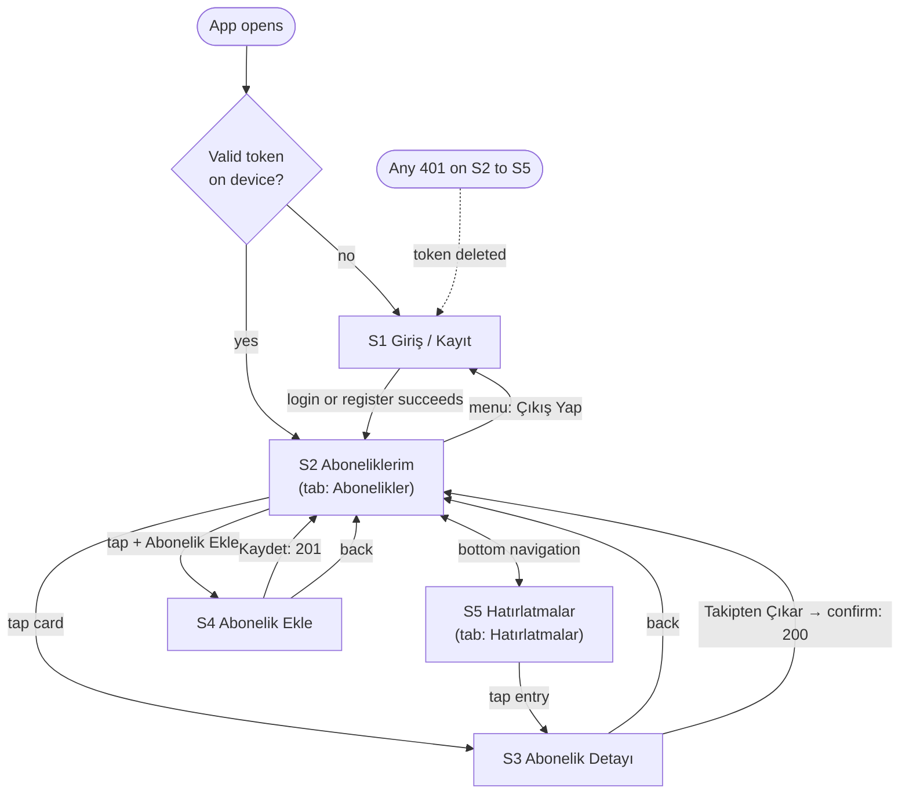
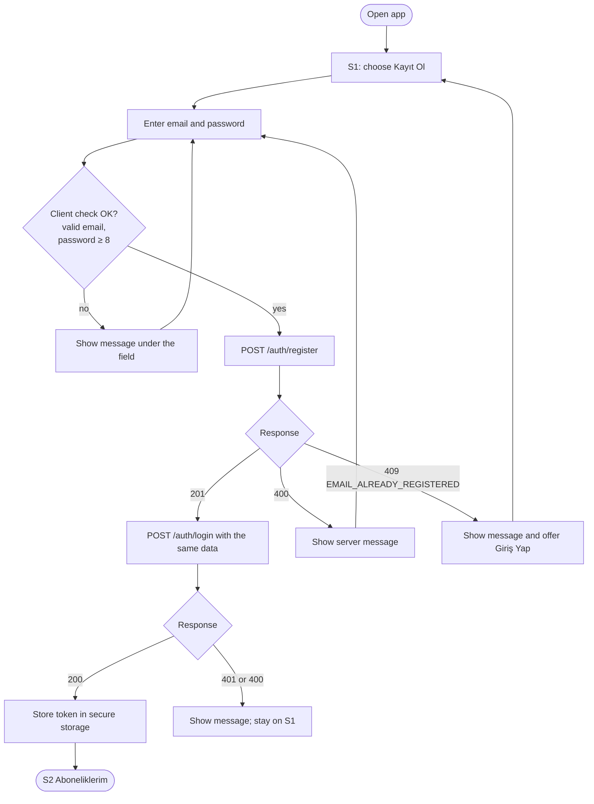
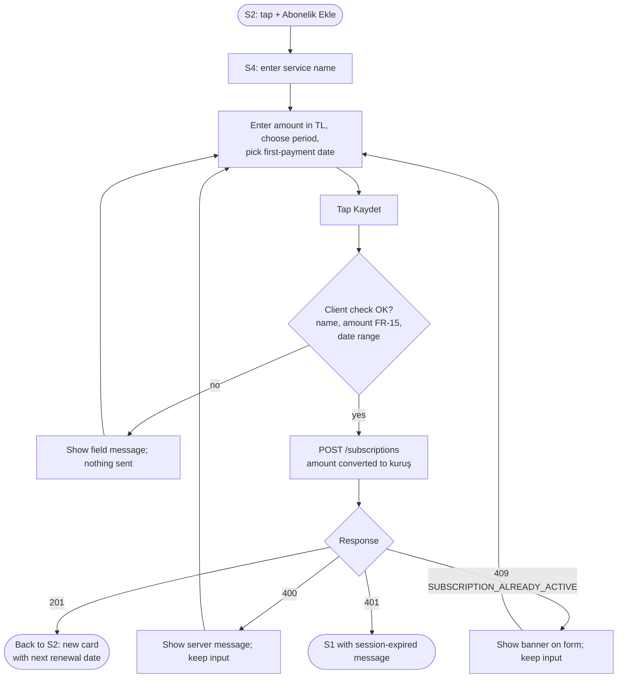
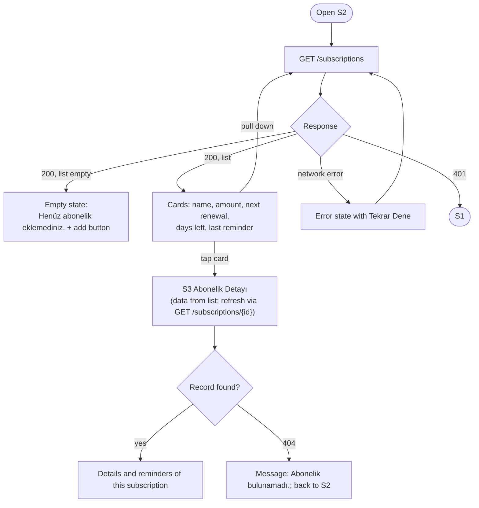
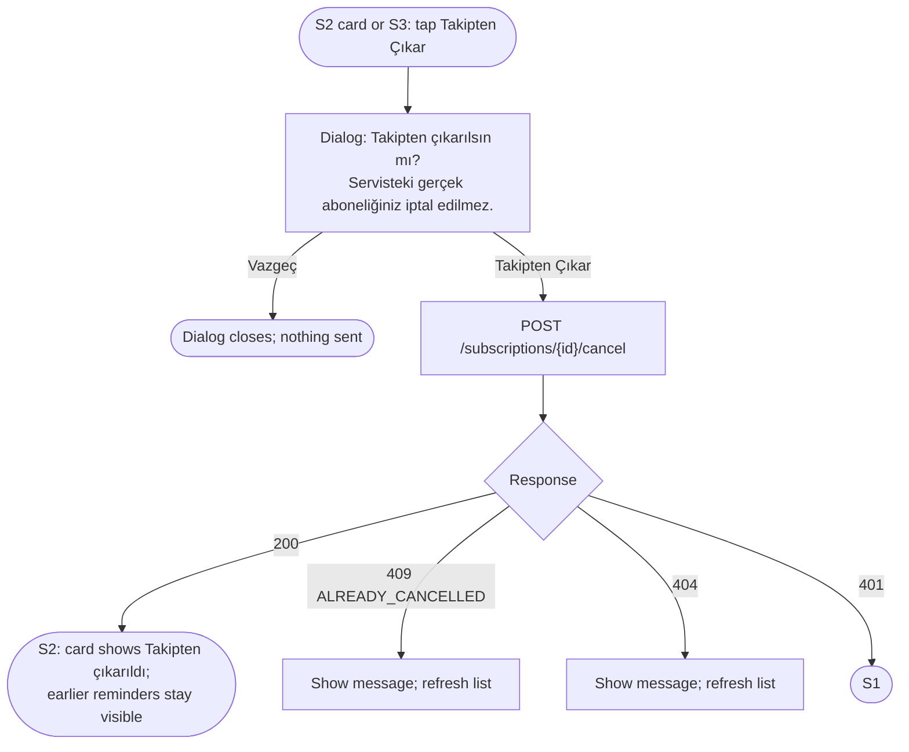
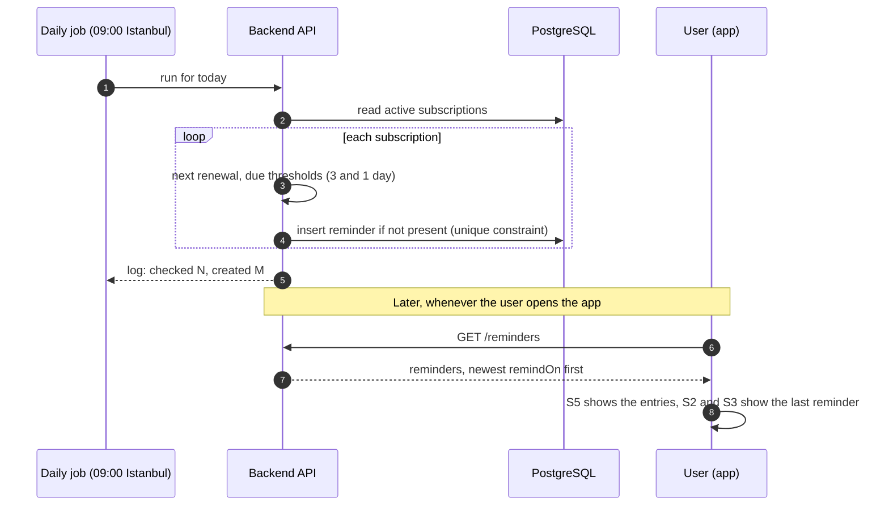
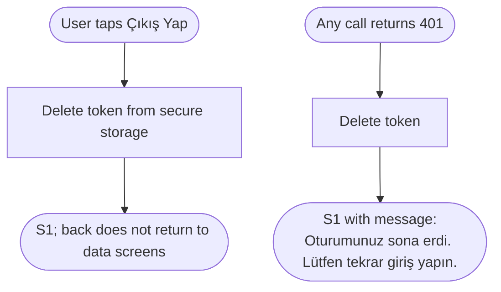
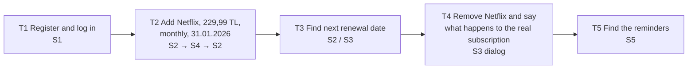

# User Flows and UI/UX Prototype Specification

**Project:** Subscription Reminder Mobile Application
**Course:** BM 321 / SENG 321 · Software Engineering Project · Sprint 2 · Team 11
**Owner:** Zeynep Sude Develi (`zsudedeveli`), Product Owner and Requirements Engineer
**Version / date:** 1.1 · 18 November 2026
**Applies decisions:** D-03, D-19, D-23, D-24, D-26
**Status:** Product Owner approved; the Figma prototype was built from this specification (task T-09)

Related documents: [SRS](03-requirements.md) (use cases UC-01 to UC-09, UIR-01 to UIR-10) · [Backlog](06-product-backlog.md) (stories, screen criteria) · [Non-functional requirements](07-nonfunctional-requirements.md) (NFR-U1 to U5) · [Early screen drafts](ekran-taslaklari.md) (Sprint 1, PR #34; superseded by this document) · [`api/openapi.yaml`](../../api/openapi.yaml)

**Figma file:** [design file](https://www.figma.com/design/zLadyqszvs7lVNyQWzMO9A/Untitled) · [clickable prototype](https://www.figma.com/proto/zLadyqszvs7lVNyQWzMO9A/Untitled?node-id=1-215&p=f&t=BNO0PVdAVM6gcWR1-0&scaling=min-zoom&content-scaling=fixed&page-id=1%3A3&starting-point-node-id=1%3A215) (view-only, "anyone with the link can view"; starts at `S1-Giris-Default`)

---

## 1. Purpose and scope

This document does three things.

1. It describes **how a user moves through the product** (user flows, section 4) as diagrams that can be exported and submitted.
2. It specifies **every screen** (section 5): components, states, Turkish texts, validation, and the API call behind each action. The Figma prototype is drawn from these specifications, so that a screen cannot show something the API cannot do.
3. It defines **what the Figma file must contain** (sections 7 and 8) and how the prototype is tested with users (NFR-U1, U4).

The Sprint 1 screen drafts (three screens) are extended to **five screens** (D-23): the reminder list (US-09) and the subscription detail (US-04) need their own screens, and the sign-in screen carries both sign-in and registration.

## 2. Design principles

| # | Principle | Consequence for the design |
|---|---|---|
| 1 | **The user must never think a real subscription was cancelled when it was not** (D-03). | The button is "Takipten Çıkar"; a confirmation states "Servisteki gerçek aboneliğiniz iptal edilmez."; the same sentence is shown on the detail screen. |
| 2 | **Show the date that matters.** The next renewal date and the days left are the main information on a card. | Date and "N gün kaldı" are on the first line group of every card. |
| 3 | **Small and fast.** Five screens, one primary action per screen. | Adding a subscription takes one form with four fields (NFR-U1: ≤ 60 s). |
| 4 | **One language.** All texts are Turkish (D-19); server messages are shown as they come. | The text catalogue (section 6) is the single source of strings. |
| 5 | **Every state is designed.** Loading, empty, error and success exist for each data screen (UIR-05). | Section 5 lists the states of each screen; Figma has one frame per state. |
| 6 | **Accessible by default.** Touch targets ≥ 48 dp, contrast ≥ 4.5 : 1, readable at 130% font size (NFR-U3). | Design tokens in section 7.2 follow these limits. |

## 3. Screen inventory and navigation

| ID | Screen (Turkish title) | Purpose | Stories | Use cases |
|---|---|---|---|---|
| S1 | Giriş / Kayıt | Sign in or register | US-01, US-02, US-11 | UC-01, UC-02, UC-09 |
| S2 | Aboneliklerim | List of subscriptions, entry to add and remove | US-03, US-04, US-05, US-07, US-08 | UC-03, UC-04, UC-06 |
| S3 | Abonelik Detayı | One subscription with its reminders; removal | US-04, US-05, US-07, US-08 | UC-05, UC-06 |
| S4 | Abonelik Ekle | Form to add a subscription | US-03, US-06 | UC-03 |
| S5 | Hatırlatmalar | Flat list of all reminders | US-09 | UC-08 |



Navigation rules:

- **Bottom navigation** with two tabs, "Abonelikler" (S2) and "Hatırlatmalar" (S5), is visible on S2 and S5 only. S1, S3 and S4 are full screens without it.
- **Back** on S3 and S4 returns to S2. Back on S2 or S5 leaves the application. After sign-out or a `401`, back must not return to a data screen.
- **Çıkış Yap** is in the top-bar menu of S2 and S5.

## 4. User flows

The diagrams of this section and of section 3 are also exported as images in [`flows/`](flows/): [screen map](flows/00-screen-map.png), [F1](flows/F1-register-login.png), [F2](flows/F2-add-subscription.png), [F3](flows/F3-view-list-detail.png), [F4](flows/F4-remove-from-tracking.png), [F5](flows/F5-reminders-sequence.png), [F6](flows/F6-end-session.png), [F7 usability journey](flows/F7-usability-journey.png).

Each flow lists the steps, the screen, the API operation, and the failure branches. The diagrams use these conventions: rounded boxes are user actions or screens, diamonds are decisions made by the system, and dashed arrows are error branches.

### 4.1 Flow F1: first use, register and log in (UC-01, UC-02)



| Step | Screen | Action | API | Failure branches |
|---|---|---|---|---|
| 1 | S1 | User chooses "Kayıt Ol", enters email and password | – | Client validation messages (UIR-04) |
| 2 | S1 | User taps "Kayıt Ol" | `registerUser` | `400` → server message; `409` → "Bu e-posta ile kayıtlı bir hesap var." and a link to sign in |
| 3 | S1 | The app signs in automatically with the same data (the registration response contains no token) | `login` | `401`/`400` → message; the user can sign in manually |
| 4 | S2 | The list opens (empty on first use, UIR-06) | `listSubscriptions` | `401` → S1 |

**Returning user:** the user chooses "Giriş Yap" on S1; wrong credentials give `401 INVALID_CREDENTIALS` with the same message for wrong password and unknown email ("E-posta veya şifre hatalı.").

### 4.2 Flow F2: add a subscription (UC-03)



| Step | Screen | Action | API | Failure branches |
|---|---|---|---|---|
| 1 | S2 | Tap "+ Abonelik Ekle" | – | – |
| 2 | S4 | Enter service name (1–100 characters) | – | "Servis adı gerekli." |
| 3 | S4 | Enter amount in lira, choose Aylık or Yıllık, pick the date of the first payment | – | Amount messages (FR-15); date message |
| 4 | S4 | Tap "Kaydet" (button disabled while the request runs) | `createSubscription` | `400`, `409`, `401` |
| 5 | S2 | The new card is shown at the top with its next renewal date | `listSubscriptions` | – |

### 4.3 Flow F3: see subscriptions and details (UC-04, UC-05)



### 4.4 Flow F4: remove a subscription from tracking (UC-06)



### 4.5 Flow F5: reminders are created and seen (UC-07, UC-08)



| Step | Screen | Action | API |
|---|---|---|---|
| 1 | – | The daily job creates due reminders for active subscriptions (no user action) | internal |
| 2 | S5 | The user opens the tab "Hatırlatmalar" | `listReminders` |
| 3 | S5 | The user taps an entry and reaches the detail of its subscription | `getSubscription` |
| 4 | S2 / S3 | Each card or detail shows the reminders of that subscription | `listSubscriptions` |

### 4.6 Flow F6: end the session (UC-09)



### 4.7 End-to-end journey used for the usability test (tasks T1 to T5)



## 5. Screen specifications

Layout is Android portrait, frame **360 × 800 dp**. Wireframes are schematic; the Figma frames follow the design tokens of section 7.2. "Server message" means the `message` field of the error response.

### 5.1 S1 · Giriş / Kayıt

Purpose: sign in or register (US-01, US-02). One screen with a two-way switch.

```text
┌────────────────────────────┐
│        [logo]  Abonelik    │
│        Hatırlatıcı         │
│                            │
│  ( Giriş Yap | Kayıt Ol )  │  ← segmented switch
│                            │
│  E-posta                   │
│  [ ayse@example.com      ] │
│  Şifre                     │
│  [ ••••••••          (göz)] │
│  En az 8 karakter          │  ← only in Kayıt Ol
│                            │
│  ⚠ server / client message │
│                            │
│  [        Giriş Yap      ] │
└────────────────────────────┘
```

| Element | Specification |
|---|---|
| Switch | "Giriş Yap" (default) and "Kayıt Ol"; switching keeps the typed email and clears messages. |
| Email field | Keyboard type email; no auto-capitalization; label "E-posta". |
| Password field | Hidden text with a show/hide toggle; label "Şifre"; helper "En az 8 karakter" in register mode only. |
| Primary button | Label follows the switch ("Giriş Yap" or "Kayıt Ol"); disabled while the request runs; shows a progress indicator. |
| Message area | One line group under the fields; red text with an icon; shows client messages or the server message. |
| API | Sign in: `login`. Register: `registerUser`, then `login` (flow F1). |

States:

| State | Content |
|---|---|
| Default | Empty fields, button enabled. |
| Loading | Button disabled with progress indicator; fields disabled. |
| Client error | Message under the offending field; no request sent. |
| Server error | Server message in the message area (400, 401, 409). |
| Session expired | Message area shows "Oturumunuz sona erdi. Lütfen tekrar giriş yapın." in neutral color. |
| Network error | "Sunucuya ulaşılamadı. Bağlantınızı kontrol edip tekrar deneyin." |

Client validation: email must look like an email address and be at most 254 characters ("Geçerli bir e-posta adresi girin."); password at least 8 characters ("Şifre en az 8 karakter olmalıdır."). The server remains the authority (UIR-04).

### 5.2 S2 · Aboneliklerim

Purpose: the home screen (US-04). Shows every subscription of the user, newest first, removed ones included (FR-07).

```text
┌────────────────────────────┐
│ Aboneliklerim          ⋮   │  ← menu: Çıkış Yap
├────────────────────────────┤
│ ┌────────────────────────┐ │
│ │ Netflix     229,99 ₺/ay│ │
│ │ Sonraki yenileme:      │ │
│ │ 28.02.2026 · 12 gün    │ │
│ │ Son hatırlatma:        │ │
│ │ 3 gün kala · 25.02.2026│ │
│ │            [Takipten Çıkar]│
│ └────────────────────────┘ │
│ ┌────────────────────────┐ │
│ │ Spotify  59,99 ₺/ay    │ │  ← removed: grey,
│ │ Takipten çıkarıldı     │ │    badge, no button
│ └────────────────────────┘ │
│                      (+)   │  ← Abonelik Ekle
├────────────────────────────┤
│ Abonelikler │ Hatırlatmalar│
└────────────────────────────┘
```

| Element | Specification |
|---|---|
| Card (active) | Service name (bold); amount with period suffix ("229,99 ₺ / ay" or "/ yıl"); "Sonraki yenileme: DD.MM.YYYY · N gün kaldı" ("yarın" when N = 1); "Son hatırlatma: N gün kala · DD.MM.YYYY" using the reminder with the latest `remindOn`, or "Henüz hatırlatma yok" when there is none; button "Takipten Çıkar". |
| Card (removed) | Grey text, badge "Takipten çıkarıldı", no renewal line, no button (UIR-09); earlier reminders still shown. |
| Card tap | Opens S3. |
| Add button | Floating button "+" with label "Abonelik Ekle"; opens S4. |
| Top-bar menu | "Çıkış Yap" (flow F6). |
| Pull to refresh | Calls `listSubscriptions` again. |
| API | `listSubscriptions` on opening and on refresh; `cancelSubscription` from the card button. |

States:

| State | Content |
|---|---|
| Loading | Three skeleton cards. |
| Empty | Illustration, "Henüz abonelik eklemediniz.", button "İlk Aboneliğini Ekle". |
| List | Cards as above. |
| Error | "Abonelikler yüklenemedi." with button "Tekrar Dene". |
| After removal | The card changes to the removed look; a snackbar "Takipten çıkarıldı." with no undo (the API has no reactivation). |

### 5.3 S3 · Abonelik Detayı

Purpose: one subscription with its reminders and the removal action (US-04, US-05).

```text
┌────────────────────────────┐
│ ←  Netflix                 │
├────────────────────────────┤
│ Tutar          229,99 ₺    │
│ Periyot        Aylık       │
│ İlk ödeme      31.01.2026  │
│ Sonraki yenileme           │
│ 28.02.2026 · 12 gün kaldı  │
│ Durum          Aktif       │
├────────────────────────────┤
│ Hatırlatmalar              │
│ 3 gün kala · 25.02.2026    │
│ Hatırlatıldı               │
│ 1 gün kala · 27.02.2026    │
│ Bekliyor                   │
├────────────────────────────┤
│ [    Takipten Çıkar      ] │
│ Servisteki gerçek aboneliğiniz │
│ iptal edilmez.             │
└────────────────────────────┘
```

| Element | Specification |
|---|---|
| Rows | Tutar (`amountKurus` shown as lira), Periyot ("Aylık"/"Yıllık"), İlk ödeme (`startDate`), Sonraki yenileme with days left, Durum ("Aktif" / "Takipten çıkarıldı"). |
| Reminder list | One entry per reminder of this subscription: "N gün kala · DD.MM.YYYY" and a status label: `sent_mock` → "Hatırlatıldı", `created` → "Bekliyor". No reminders: "Henüz hatırlatma yok." |
| Removal | Button "Takipten Çıkar" (outlined, red) and, always visible under it, "Servisteki gerçek aboneliğiniz iptal edilmez." Hidden for a removed subscription. Opens the dialog of section 5.6. |
| API | Data from the list; refreshed with `getSubscription`. `404` shows "Abonelik bulunamadı." and returns to S2. |

### 5.4 S4 · Abonelik Ekle

Purpose: add a subscription (US-03, US-06).

```text
┌────────────────────────────┐
│ ←  Abonelik Ekle           │
├────────────────────────────┤
│ Servis adı                 │
│ [ Netflix              ]   │
│ Tutar (₺)          TRY     │
│ [ 229,99               ]   │
│ Örn. 229,99                │
│ Periyot                    │
│ ( Aylık | Yıllık )         │
│ İlk ödeme tarihi           │
│ [ 31.01.2026        📅 ]   │
│ İlk ödemenin yapıldığı gün │
│ (geçmiş bir tarih olabilir)│
│                            │
│ ⚠ banner: server message   │
│ [        Kaydet          ] │
└────────────────────────────┘
```

| Field | Specification | Client messages |
|---|---|---|
| Servis adı | Text, 1–100 characters, trimmed; character counter near the limit. | "Servis adı gerekli." · "Servis adı en fazla 100 karakter olabilir." |
| Tutar (₺) | Decimal keyboard; accepts comma or point; at most two decimals; converted to kuruş without rounding (FR-15); a fixed label "TRY" next to it, never sent in the request (UIR-08). | "Geçerli bir tutar girin (örn. 229,99)." · "Tutar sıfırdan büyük olmalıdır." · "Tutarda en fazla iki ondalık basamak olabilir." |
| Periyot | Two-way switch "Aylık" (default) / "Yıllık" → `monthly` / `yearly`. | – |
| İlk ödeme tarihi | Date picker; shown `DD.MM.YYYY`, sent `YYYY-MM-DD`; allowed 01.01.2000 to 366 days after today; helper text explains that it is the day of the first payment and may be in the past (D-16). | "Tarih seçin." · "Tarih 01.01.2000 ile bugünden itibaren 366 gün sonrası arasında olmalıdır." |
| Kaydet | Disabled while the request runs. | – |

States: Default (empty form), Field error (message under the field, nothing sent), Loading (button with progress indicator), Server error (banner with the server message, **entered data is kept**), Success (return to S2).

Examples of server banners: `409` "Bu servis ve periyot için aktif bir abonelik zaten var."; `400` the server message.

### 5.5 S5 · Hatırlatmalar

Purpose: the flat, read-only history of reminders (US-09, D-08).

```text
┌────────────────────────────┐
│ Hatırlatmalar          ⋮   │
├────────────────────────────┤
│ Netflix                    │
│ 1 gün kala · 27.02.2026    │
│ Yenileme: 28.02.2026       │
├────────────────────────────┤
│ Netflix                    │
│ 3 gün kala · 25.02.2026    │
│ Yenileme: 28.02.2026       │
├────────────────────────────┤
│ Abonelikler │ Hatırlatmalar│
└────────────────────────────┘
```

| Element | Specification |
|---|---|
| Entry | Service name; "N gün kala · DD.MM.YYYY" (`daysBefore`, `remindOn`); "Yenileme: DD.MM.YYYY" (`renewalDate`); status label as on S3. Tap opens S3 of that subscription. |
| Order | As returned by the API: `remindOn` descending, then `daysBefore` ascending (FR-13). No sorting or filtering in the client. |
| Service name | `listReminders` returns the `subscriptionId`, not the name. The client resolves the name from the subscription list it already holds (S2) and shows "Abonelik" if the subscription is not found. |
| States | Loading (skeleton), Empty ("Henüz hatırlatma yok."), List, Error ("Hatırlatmalar yüklenemedi." + "Tekrar Dene"). |
| API | `listReminders` on opening and on pull to refresh. |

### 5.6 Dialogs and messages (shared)

**Removal dialog** (UIR-03):

```text
┌──────────────────────────────┐
│ Takipten çıkarılsın mı?      │
│                              │
│ Servisteki gerçek            │
│ aboneliğiniz iptal edilmez.  │
│                              │
│        [Vazgeç] [Takipten Çıkar]│
└──────────────────────────────┘
```

The title and the sentence are fixed. The confirming button is red. "Vazgeç" closes the dialog and sends nothing.

**Snackbar** (bottom, 4 seconds): "Takipten çıkarıldı." after removal; "Abonelik eklendi." after adding.

## 6. Text catalogue (Turkish)

| Key | Text |
|---|---|
| app.title | Abonelik Hatırlatıcı |
| auth.tab.login | Giriş Yap |
| auth.tab.register | Kayıt Ol |
| auth.email | E-posta |
| auth.password | Şifre |
| auth.passwordHelper | En az 8 karakter |
| auth.err.email | Geçerli bir e-posta adresi girin. |
| auth.err.password | Şifre en az 8 karakter olmalıdır. |
| auth.sessionExpired | Oturumunuz sona erdi. Lütfen tekrar giriş yapın. |
| common.networkError | Sunucuya ulaşılamadı. Bağlantınızı kontrol edip tekrar deneyin. |
| common.retry | Tekrar Dene |
| menu.logout | Çıkış Yap |
| nav.subscriptions | Abonelikler |
| nav.reminders | Hatırlatmalar |
| list.title | Aboneliklerim |
| list.empty | Henüz abonelik eklemediniz. |
| list.emptyAction | İlk Aboneliğini Ekle |
| list.add | Abonelik Ekle |
| list.error | Abonelikler yüklenemedi. |
| card.nextRenewal | Sonraki yenileme: {date} · {n} gün kaldı |
| card.nextRenewalTomorrow | Sonraki yenileme: {date} · yarın |
| card.lastReminder | Son hatırlatma: {n} gün kala · {date} |
| card.noReminder | Henüz hatırlatma yok |
| card.removedBadge | Takipten çıkarıldı |
| card.perMonth / card.perYear | / ay · / yıl |
| detail.title | Abonelik Detayı |
| detail.amount / .period / .firstPayment / .nextRenewal / .status | Tutar · Periyot · İlk ödeme · Sonraki yenileme · Durum |
| period.monthly / period.yearly | Aylık · Yıllık |
| status.active / status.cancelled | Aktif · Takipten çıkarıldı |
| detail.reminders | Hatırlatmalar |
| reminder.line | {n} gün kala · {date} |
| reminder.sentMock / reminder.created | Hatırlatıldı · Bekliyor |
| remove.button | Takipten Çıkar |
| remove.dialogTitle | Takipten çıkarılsın mı? |
| remove.warning | Servisteki gerçek aboneliğiniz iptal edilmez. |
| remove.cancel | Vazgeç |
| remove.done | Takipten çıkarıldı. |
| add.title | Abonelik Ekle |
| add.serviceName | Servis adı |
| add.amount | Tutar (₺) |
| add.amountHint | Örn. 229,99 |
| add.currency | TRY |
| add.period | Periyot |
| add.startDate | İlk ödeme tarihi |
| add.startDateHint | İlk ödemenin yapıldığı gün (geçmiş bir tarih olabilir) |
| add.save | Kaydet |
| add.done | Abonelik eklendi. |
| add.err.name | Servis adı gerekli. |
| add.err.nameLength | Servis adı en fazla 100 karakter olabilir. |
| add.err.amount | Geçerli bir tutar girin (örn. 229,99). |
| add.err.amountZero | Tutar sıfırdan büyük olmalıdır. |
| add.err.amountDecimals | Tutarda en fazla iki ondalık basamak olabilir. |
| add.err.date | Tarih seçin. |
| add.err.dateRange | Tarih 01.01.2000 ile bugünden itibaren 366 gün sonrası arasında olmalıdır. |
| reminders.title | Hatırlatmalar |
| reminders.empty | Henüz hatırlatma yok. |
| reminders.error | Hatırlatmalar yüklenemedi. |
| reminders.renewal | Yenileme: {date} |
| notFound | Abonelik bulunamadı. |

Server messages (`message`) are shown as returned; the examples are in the [SRS](03-requirements.md) section 3.8.

## 7. Design system for the prototype

### 7.1 Base

Material Design 3 baseline for Android; Roboto; frame 360 × 800 dp; 8 dp spacing grid; screen side margins 16 dp; corner radius 12 dp for cards and 8 dp for fields; light theme only (dark theme is out of scope).

### 7.2 Design tokens (proposal; verify contrast in Figma before use)

| Token | Value | Use |
|---|---|---|
| color/primary | `#3B5BDB` | Primary buttons, selected tab, links |
| color/on-primary | `#FFFFFF` | Text on primary |
| color/background | `#F8F9FA` | Screen background |
| color/surface | `#FFFFFF` | Cards, dialogs |
| color/text | `#212529` | Main text |
| color/text-secondary | `#495057` | Secondary text (checked ≥ 4.5 : 1 on white) |
| color/danger | `#C92A2A` | Errors, "Takipten Çıkar", destructive button |
| color/success | `#2B8A3E` | Positive status |
| color/muted | `#868E96` | Removed cards (text only; do not use for essential information) |
| type/title | Roboto Medium 20 sp | Screen titles |
| type/body | Roboto Regular 16 sp | Body, fields |
| type/caption | Roboto Regular 14 sp | Secondary lines |
| size/touch | 48 × 48 dp minimum | All tappable elements |

### 7.3 Components

| Component | Variants and states |
|---|---|
| Button | Primary (filled), Secondary (outlined), Danger (outlined red); default, pressed, disabled, loading |
| Text field | Default, focused, filled, error (message below), disabled; with helper text |
| Segmented switch | Two options; selected and unselected |
| Subscription card | Active, removed, with reminder, without reminder |
| Reminder entry | Created, sent (mock) |
| Top app bar | With title; with back arrow; with overflow menu |
| Bottom navigation | Two items; selected state |
| Dialog | Title, body text, two buttons |
| Snackbar | Text only |
| Empty state | Illustration, text, optional button |
| Skeleton | Card placeholder |

### 7.4 Contrast review (19 November 2026)

The contrast of every color pair used in the Figma frames was calculated (WCAG ratio). All pairs reach 4.5 : 1 except the four below. The Figma file keeps the tokens of section 7.2; the corrected values are used in the application (Sprint 3).

| Pair | Ratio now | Corrected value | Ratio after |
|---|---|---|---|
| `color/success` `#2B8A3E` on white | 4.37 | `#237B34` | 5.31 |
| `color/success` on the status chip `#EBFBEE` | 4.07 | `#237B34` | 4.95 |
| `color/primary` `#3B5BDB` on the selected-tab pill `#DBE4FF` | 4.47 | `#364FC7` | 5.34 |
| `color/muted` `#868E96` on white (removed cards) | 3.32 | `#6C757D` | 4.69 |

## 8. Figma file requirements (task T-09)

### 8.1 Structure

Figma's free plan allows three pages per file, so the five planned pages were combined into three. Connections of a prototype work only between frames of one page, so screens and prototype share a page.

| Page | Content |
|---|---|
| 0 Cover and design system | Design tokens (colors, type, spacing) as a sheet (`DS-Tokens`) |
| 1 User flows | The diagrams of section 4 (F1 to F6, screen map and the end-to-end journey), imported from the PNG files in `flows/` |
| 2 Screens and prototype | One frame per screen state (list below), 360 × 800 dp, and the connected prototype with the starting frame `S1-Giris-Default` |

Frames are named as in the list below; Figma adds a numeric suffix to imported frames (for example `S1-Giris-Default 1`).

### 8.2 Frames to draw

| Frame name | State |
|---|---|
| S1-Giris-Default · S1-Giris-Loading · S1-Giris-Error · S1-Giris-SessionExpired | Sign-in mode |
| S1-Kayit-Default · S1-Kayit-ClientError · S1-Kayit-EmailTaken | Register mode |
| S2-Liste-Empty · S2-Liste-Loading · S2-Liste-Default · S2-Liste-Error · S2-Liste-AfterRemoval | List |
| S2-Menu-Logout | Overflow menu open |
| S3-Detay-Active · S3-Detay-Removed · S3-Detay-NoReminders | Detail |
| S3-Dialog-Remove | Removal dialog |
| S4-Ekle-Empty · S4-Ekle-FieldErrors · S4-Ekle-Duplicate409 · S4-Ekle-Loading | Add form |
| S5-Hatirlatma-Default · S5-Hatirlatma-Empty · S5-Hatirlatma-Error | Reminders |

### 8.3 Prototype connections

| From (frame, element) | To | Trigger | Transition |
|---|---|---|---|
| S1-Giris-Default, "Giriş Yap" | S2-Liste-Default | Tap | Navigate, no back stack |
| S1-Kayit-Default, "Kayıt Ol" | S2-Liste-Empty | Tap | Navigate, no back stack |
| S1 switch | S1 other mode | Tap | Change to variant |
| S2-Liste-Default, card | S3-Detay-Active | Tap | Push |
| S2-Liste-Default, "+" | S4-Ekle-Empty | Tap | Push |
| S4-Ekle-Empty, "Kaydet" | S2-Liste-Default | Tap | Navigate back with snackbar "Abonelik eklendi." |
| S3-Detay-Active, "Takipten Çıkar" | S3-Dialog-Remove | Tap | Open overlay |
| S3-Dialog-Remove, "Takipten Çıkar" | S2-Liste-AfterRemoval | Tap | Navigate back with snackbar |
| S3-Dialog-Remove, "Vazgeç" | S3-Detay-Active | Tap | Close overlay |
| S2 bottom navigation, "Hatırlatmalar" | S5-Hatirlatma-Default | Tap | Instant |
| S5 entry | S3-Detay-Active | Tap | Push |
| S2-Menu-Logout, "Çıkış Yap" | S1-Giris-Default | Tap | Navigate, no back stack |

The prototype must allow the usability tasks T1 to T5 (section 4.7) without leaving it.

### 8.4 Checklist before sharing

- [ ] Every screen state of section 8.2 exists and uses the texts of section 6.
- [ ] The removal dialog text and the button name are exactly as in UIR-03.
- [x] Touch targets are at least 48 × 48 dp; text contrast is at least 4.5 : 1 (calculated for every color pair; four exceptions with corrections in section 7.4).
- [ ] All connections of section 8.3 work in presentation mode from the first frame.
- [x] The file is shared with "anyone with the link can view"; the link is entered at the top of this document and in the Sprint 2 submission file.
- [ ] The user-flow diagrams exist as PNG in `docs/product/flows/` (exported from the Mermaid sources of this document, so that they are in the repository history); the Figma page "1 User flows" shows the same flows.
- [ ] A short PDF export of the screens is added to `docs/product/` if the instructor asks for files instead of a link.

## 9. Traceability: screens, requirements, API

| Screen | Requirements | API operations | Acceptance | NFR checked on the prototype |
|---|---|---|---|---|
| S1 | FR-01, FR-02, FR-14, UIR-02, UIR-04, UIR-05 | `registerUser`, `login` | AT-01 to AT-06, AT-31, AT-32 | NFR-U3, U5 |
| S2 | FR-03, FR-06, FR-07, FR-09, FR-12, UIR-05 to UIR-07, UIR-09 | `listSubscriptions`, `cancelSubscription` | AT-11, AT-16, AT-17, AT-26 | NFR-U3 |
| S3 | FR-06, FR-08, FR-09, UIR-03, UIR-09 | `getSubscription`, `cancelSubscription` | AT-10, AT-16, AT-17 | NFR-U4 |
| S4 | FR-04, FR-05, FR-15, UIR-04, UIR-08 | `createSubscription` | AT-08, AT-09, AT-12 to AT-15, AT-33, AT-34 | NFR-U1 |
| S5 | FR-13, UIR-05, UIR-06 | `listReminders` | AT-28, AT-29 | NFR-U3 |

## 10. Open points

| # | Point | Owner | Due |
|---|---|---|---|
| 1 | The Implementation engineer confirms that the five-screen structure and the "register, then sign in automatically" step (F1) are feasible for the skeleton T-05 (the skeleton may start with S1 and S2). | Implementation | Sprint 2 review |
| 2 | The Architect confirms that S5 can resolve service names from the subscription list (no contract change, see 5.5); if not, a contract change that adds `serviceName` to `Reminder` is proposed through the Architect. | Architect | Sprint 2 review |
| 3 | The Figma view link is entered at the top of this document and in `docs/SPRINT-2-SUBMISSION.md`. | PO | Done (18 Nov 2026) |
| 4 | Usability test with 5 participants on the prototype; results in `docs/qa/usability-test-sprint-2.md` (NFR-U1, U4). | PO, QA | 23 Nov 2026 |
